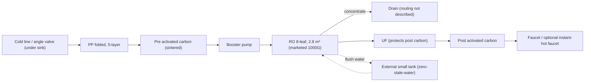
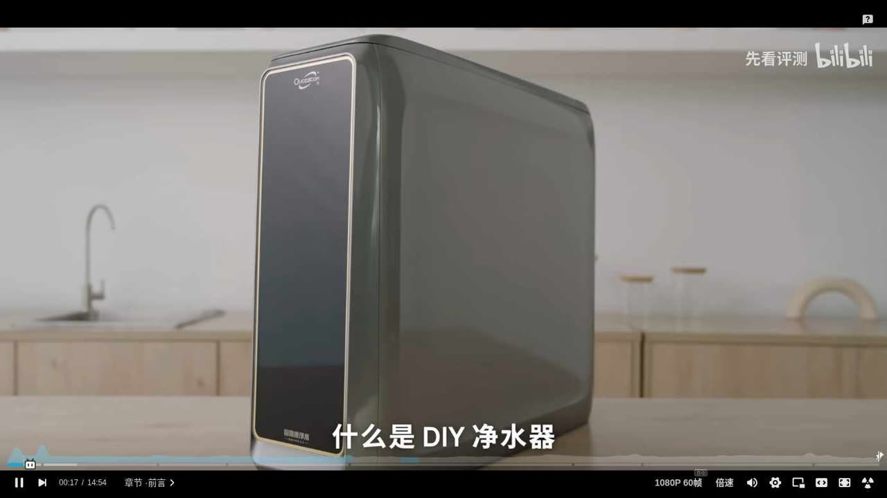
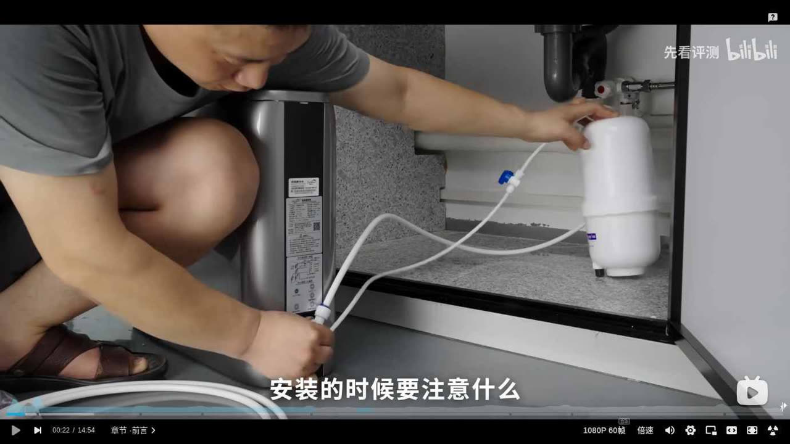

# 01 · BV1oW421X7bA: 先看评测 "1000G full-spec DIY purifier"

> Rank 1 of the relevant results for the Bilibili search 「DIY净水器」 sorted by plays (search position #2; #1 was skipped, see [index](README.md)).
> **Nature of the video:** a product launch. The channel had a factory build a "DIY-style" purifier from universal (generic-standard) parts and sells it. It isn't a home-built rig. It's included because it explains a full DIY architecture and the reasons behind each design choice.

## 1. Metadata

| Field | Value |
|---|---|
| Title (zh) | 滤芯竟然这么便宜，我们自己 DIY 了一台满配净水器！ |
| Title (en) | "Filters are this cheap?! We DIY'd a fully-loaded water purifier ourselves!" |
| Uploader | 先看评测 |
| Link | https://www.bilibili.com/video/BV1oW421X7bA |
| Plays | 1,672,300 (Bilibili search API, 2026-10-18) |
| Published | 2024-08-08 |
| Duration | 14:54 |

**Sources used:** Bilibili search-API metadata and description; a re-transcription of the audio saved by an earlier run (faster-whisper `small`; **approximate**); the YouTube mirror's description (`M-m6Hqr0EB8`, same channel, which adds prices); 3 top comments fetched before Bilibili started returning HTTP 412; 2 player screenshots captured by the earlier run.

## 2. Architecture

Description (YouTube mirror): *"1000G high flux, true zero-stale-water, dual activated carbon (pre and post), plus an instant-hot faucet."*

Water path, in order (stage contents are **from auto-transcript, approximate**, unless noted otherwise):

1. **Inlet:** under-sink connection to the cold-water line. The screenshot shows white tubing run to the under-sink angle valve area. The exact tee/valve part isn't visible clearly enough to confirm.
2. **PP (sediment):** folded PP, upgraded to 5 layers and double height, with a reinforced inner support cage "to even out water pressure and prevent collapse" (from auto-transcript, approximate).
3. **Activated carbon (pre):** "real sintered carbon" instead of the compressed carbon common at this price. An optional Korean fiber + carbon composite cartridge is offered for better removal of residual chlorine and "raw-water taste" (from auto-transcript, approximate).
4. **Booster pump:** "first-tier brand", a higher-grade model whose cost is ~50% higher than the pumps in comparable machines they tore down (from auto-transcript, approximate). Brand not stated in what was readable.
5. **RO membrane:** customized with Hainar (海纳, as transcribed). 8 long leaves, effective area **2.8 m²**, rated **1200G+** in Shenzhen tests, marketed as **1000G** (from auto-transcript, approximate). They say the machine still accepts standard universal membranes. Lab report quoted: after 6 t of water, conductivity rejection 91% (standard requires ≥85%) and total-hardness rejection 93.7% (requirement stated as ≥90%) (from auto-transcript, approximate; the standard number isn't named in the transcript).
6. **Zero-stale-water:** modeled on brand "352"'s approach, done with an **external small pressure tank** that holds water used to flush the membrane. The tank must fit under the sink and they call it the design's main aesthetic drawback (from auto-transcript, approximate). The screenshot shows a small white tank under the sink.
7. **Post filter:** post activated carbon (Japanese carbon) **protected by an imported Korean UF stage**, because papers and industry experts warned that post carbon gets contaminated by bacteria "crawling back from the outlet" (from auto-transcript, approximate).
8. **Heating:** optional thick-film **instant-hot faucet**, sold separately (¥749, YouTube description).
9. **Electronics:** a "computer board, power supply, solenoid valves" are listed among the non-filter parts (from auto-transcript, approximate). No details given.
10. **Enclosure:** a fully enclosed tower housing (screenshot). It isn't a rack or plate.
11. **Waste water:** not described in the readable transcript.
12. **UV / leak protection:** not mentioned in the readable transcript. A top comment asks how they handle leaks (see §5).

*The exact position of the zero-stale-water tank in the circuit isn't explained in the readable transcript. The dotted links show its function, not its verified plumbing.*

## 3. Tags

| Dimension | Finding |
|---|---|
| Inlet method | Under-sink cold-line connection (screenshot). Tee type not confirmed |
| Filter stages | PP → pre carbon → RO → UF → post carbon (from auto-transcript, approximate) |
| RO membrane & pump | Custom 8-leaf 2.8 m², marketed 1000G. "First-tier" higher-grade pump |
| Storage | No storage tank. External small tank only for zero-stale-water flushing |
| Water safety | Addresses stale water and post-carbon bacterial contamination (UF guard). Claims official approvals (涉水批文). Criticized competitors' housings that smelled of plastic |
| Sterilization (UV) | Not mentioned |
| Heating | Optional instant-hot faucet, thick-film, ¥749 |
| Leak/flood protection | Not mentioned (raised in comments) |
| Structure & portability | Enclosed tower plus a separate small tank. Installation service "recommended", self-install video provided |
| Electronics & smart | Board, power supply, solenoid valves mentioned. No detail |
| Brands | Hainar (membrane, as transcribed), "352" (design reference) |
| Cost (BOM) | BOM cost "over ¥1000" (transcript). Retail ¥1499 after coupon (YouTube description) |
| Maintenance | Universal-standard cartridges, no lock-in. RO realistically 2–3 years under the standard's test water, per their argument (from auto-transcript, approximate) |

## 4. BOM

No itemized BOM. Only these figures were found: BOM cost > ¥1000 (transcript); retail ¥1499; faucet ¥749; combo ¥2198 (YouTube description).

## 5. Problems / pitfalls raised

| Problem | Source | Solution mentioned? |
|---|---|---|
| Cheap "DIY" units mislabel flux (an "800G" unit actually uses a 600G or 400G membrane), use parts without approvals, and have housings that smell of plastic | Transcript | Yes: they chose higher-grade suppliers (their own product) |
| First glass in the morning has high TDS / stale taste | Transcript | Yes: zero-stale-water flushing via an external tank |
| Post carbon contaminated by bacteria from the outlet | Transcript | Yes: UF in front of the post carbon |
| "5-year membrane life" claims are meaningless without a stated test water | Transcript | Partial: publish rejection data from a stamped lab report |
| Under-sink space must fit the extra tank | Transcript | No (they call it a drawback) |
| Who handles leaks/flooding, nationwide installation, and winter freezing in the north? | Top comment (时光的巨流河, 1,541 likes) | No answer captured |
| A commenter says premium generic parts (Taiwan 松泉 housings, 三角洲/柏繁 pump, 南阳/科博 valves, Taiwan CCK tube, 冠宇达 transformer) come to about ¥700 | Top comment (放开那只鸡, 995 likes) | n/a (alternative BOM claim, unverified) |

## 6. Architecture screenshots

These are player screenshots captured by the earlier research run (2026-10-17). New frames couldn't be extracted this run because Bilibili returned HTTP 412 (see index).

*00:17: the product is a single enclosed tower housing.*

*00:22: installing under the sink. Tubing goes to the angle-valve area, and a small white tank sits beside the unit (consistent with the zero-stale-water tank described).*
