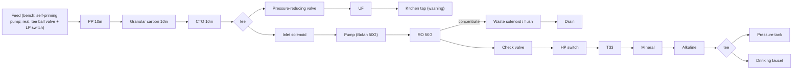

# 02 · BV1C54y1v7mC: Mr迷瞪 "DIY your own purifier" (8-stage, pressure tank)

## 1. Metadata

| Field | Value |
|---|---|
| Title (zh) | 【迷瞪】自己动手，安个净水器吧 |
| Title (en) | "[Mideng] Do it yourself: install a water purifier" |
| Uploader | Mr迷瞪 |
| Link | https://www.bilibili.com/video/BV1C54y1v7mC |
| Plays | 528,896 (Bilibili search API, 2026-10-18) |
| Published | 2020-07-31 |
| Duration | 7:43 |

**Sources used:** search-API metadata (the description only has a QQ group); a re-transcription of the audio saved by the earlier run (faster-whisper `small` with VAD; **approximate**, though this one is fairly clean). Comments, including the uploader's own BOM comment, **couldn't be fetched** this run (HTTP 412).

## 2. Architecture

Everything below is **from auto-transcript, approximate** unless noted.

1. **Frame:** a generic universal hanging rack ("like a PC case"). All parts are screwed onto it.
2. **Inlet:** the build was a bench test fed by a **self-priming pump** (not plumbed in). He says real installs should use a **booster pump** with a feed **tee ball valve** on the household line, plus a dual-outlet faucet. Neither was in his list.
3. **Pre-filters:** three 10-inch housings. **PP → granular carbon (颗粒碳) → compressed carbon (CTO)**. PP + carbon + PP also works. Flush the carbon fines out before connecting the UF/RO lines. Pre-filters are changed about yearly; generic 10" cartridges cost about ¥20 for three, versus about ¥100 each for brand ones.
4. **Split after stage 3 (tee):**
   - **UF branch:** tee → **pressure-reducing valve** (because the whole system runs at RO pressure when a self-priming pump is used) → UF → kitchen-use faucet (washing vegetables).
   - **RO branch:** inlet solenoid valve → pump (博凡 / Bofan 50G pump mentioned) → **50G RO** in a matching membrane housing.
5. **RO product line:** check valve ("prevents pressure-tank backflow") → **high-pressure switch** → post stages in series: **T33 carbon** (taste) → **mineralization cartridge** (adds potassium and metasilicic acid) → **alkaline cartridge** (raises pH) → tee → **pressure tank** + faucet.
6. **Waste:** RO concentrate → **waste-water solenoid valve** (flush), then joined with another line by a tee into the drain.
7. **Electronics:** 220 V→24 V DC power supply plus a generic purifier control board. Wire colors on his board: yellow = low-pressure switch, blue = high-pressure switch, black = inlet solenoid, red = waste solenoid, green = pump, pink/white = PSU +/−. He skipped the low-pressure switch (yellow wires shorted) but recommends one at the very front of the line on real plumbing, to protect the pump when the water supply cuts out.
8. **Tubing:** CCK PE 2-point (1/4") tube, 25 m bought at ¥1/m. About 15–20 m is enough.
9. **UV, leak protection, heating:** not mentioned.
10. **Result:** a lab water report shown. UF barely changes hardness; RO is very effective; the mineral cartridge adds metasilicic acid and potassium; the alkaline cartridge pushed pH "a bit too far".

## 3. Tags

| Dimension | Finding |
|---|---|
| Inlet method | Bench: self-priming pump. Recommended: tee ball valve on the household line plus an LP switch |
| Filter stages | 8: PP, GAC, CTO, UF (side branch), RO, T33, mineral, alkaline |
| RO membrane & pump | 50G RO with Bofan 50G-class pump. 三角洲 (Delta) and other domestic pumps recommended |
| Storage | Pressure tank (don't touch the air valve during install) |
| Water safety | Lab report shown. Stale water not discussed |
| Sterilization (UV) | Not mentioned |
| Heating | Not mentioned |
| Leak/flood protection | Not mentioned |
| Structure & portability | Open universal hanging rack |
| Electronics & smart | Generic control board, 24 V PSU, HP/LP switches, 2 solenoids |
| Brands | CCK tube, 博凡 (Bofan) pump, 三角洲 mentioned |
| Cost (BOM) | Says "总计价格134块钱" (¥134) right after listing valves/elbows/adapters. It's unclear whether that's the total or only the fittings (from auto-transcript, approximate). Full list "pinned in comments", not fetched |
| Maintenance | Pre-filters yearly. RO about 2 years. Run the faucet about 1 h on first use (carbon fines) |

## 4. BOM

The uploader says the parts list is in a comment he pinned. **It couldn't be fetched this run (HTTP 412).** The earlier run noted "BOM in his own comment" but didn't keep its text, so nothing is reproduced here.

## 5. Problems / pitfalls raised (video)

| Problem | Solution mentioned? |
|---|---|
| Carbon fines can foul the UF/RO on first fill | Yes: disconnect the downstream lines and flush first |
| Brand cartridges use non-standard connectors to force lock-in | Yes: DIY with generic 10" / quick-connect cartridges |
| Push-fit tube not fully seated (leaks) | Yes: push again until it goes in another notch; cut tubes long rather than short |
| A self-priming pump puts RO pressure on the UF branch | Yes: pressure-reducing valve before the UF |
| No LP switch means the pump runs dry when the water supply cuts out | Yes: add an LP switch at the front |
| Low-voltage wiring splices | Yes: insulate with tape |
| Black water at first draw | Yes: carbon dust, flush about 1 h |
| Alkaline cartridge over-raises pH | Partial: noted only |

## 6. Architecture screenshots

**No screenshot available.** Bilibili returned HTTP 412 to this box, so the video couldn't be downloaded, and the cover (a generic faucet photo with "DIY净水器全攻略") shows no architecture.
