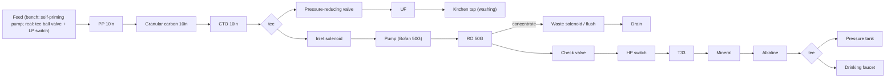

# 02 · BV1C54y1v7mC: Mr迷瞪 "DIY your own purifier" (8-stage, pressure tank)

## 1. Metadata

| Field | Value |
|---|---|
| Title (zh) | 【迷瞪】自己动手，安个净水器吧 |
| Title (en) | "[Mideng] Do it yourself: install a water purifier" |
| Uploader | Mr迷瞪 |
| Link | https://www.bilibili.com/video/BV1C54y1v7mC |
| Plays | 529,004 (Bilibili view API, 2026-10-20) |
| Published | 2020-07-31 |
| Duration | 7:43 |
| aid | 841517781 |

**Sources used:** search-API metadata + audio transcript from prior runs. **2026-10-20 ~20:28 Asia/Shanghai Phase A:** anonymous `x/web-interface/view` + `x/v2/reply/main` (HTTP 200) fetched the uploader **BOM comment** (hottest reply; not in `top.upper` but uploader-authored list). Description still only notes QQ `992102294`. Architecture below remains **transcript-based** unless marked otherwise. No yt-dlp this pass.

## 2. Architecture

Everything below is **from auto-transcript, approximate** unless noted.

1. **Frame:** a generic universal hanging rack ("like a PC case"). All parts are screwed onto it.
2. **Inlet:** the build was a bench test fed by a **self-priming pump** (not plumbed in). He says real installs should use a **booster pump** with a feed **tee ball valve** on the household line, plus a dual-outlet faucet. Neither was in his list.
3. **Pre-filters:** three 10-inch housings. **PP → granular carbon (颗粒碳) → compressed carbon (CTO)**. PP + carbon + PP also works. Flush the carbon fines out before connecting the UF/RO lines. Pre-filters are changed about yearly; generic 10" cartridges cost about ¥20 for three, versus about ¥100 each for brand ones.
4. **Split after stage 3 (tee):**
   - **UF branch:** tee → **pressure-reducing valve** (because the whole system runs at RO pressure when a self-priming pump is used) → UF → kitchen-use faucet (washing vegetables).
   - **RO branch:** inlet solenoid valve → pump (博凡 / Bofan 50G pump mentioned) → **50G RO** in a matching membrane housing.
5. **RO product line:** check valve ("prevents pressure-tank backflow") → **high-pressure switch** → post stages in series: **T33 carbon** (taste) → **mineralization cartridge** (adds potassium and metasilicic acid) → **alkaline cartridge** (raises pH) → tee → **pressure tank** + faucet.
6. **Waste:** RO concentrate → **waste-water solenoid valve** (flush), then joined with another line by a tee into the drain.
7. **Electronics:** 220 V→24 V DC power supply plus a generic purifier control board. Wire colors on his board: yellow = low-pressure switch, blue = high-pressure switch, black = inlet solenoid, red = waste solenoid, green = pump, pink/white = PSU +/−. He skipped the low-pressure switch (yellow wires shorted) but recommends one at the very front of the line on real plumbing, to protect the pump when the water supply cuts out.
8. **Tubing:** CCK PE 2-point (1/4") tube, 25 m bought at ¥1/m. About 15–20 m is enough.
9. **UV, leak protection, heating:** not mentioned.
10. **Result:** a lab water report shown. UF barely changes hardness; RO is very effective; the mineral cartridge adds metasilicic acid and potassium; the alkaline cartridge pushed pH "a bit too far".

## 3. Tags

| Dimension | Finding |
|---|---|
| Inlet method | Bench: self-priming pump. Recommended: tee ball valve on the household line plus an LP switch |
| Filter stages | 8: PP, GAC, CTO, UF (side branch), RO, T33, mineral, alkaline |
| RO membrane & pump | 50G RO with Bofan 50G-class pump. 三角洲 (Delta) and other domestic pumps recommended |
| Storage | Pressure tank (don't touch the air valve during install) |
| Water safety | Lab report shown. Stale water not discussed |
| Sterilization (UV) | Not mentioned |
| Heating | Not mentioned |
| Leak/flood protection | Not mentioned |
| Structure & portability | Open universal hanging rack |
| Electronics & smart | Generic control board, 24 V PSU, HP/LP switches, 2 solenoids |
| Brands | CCK tube, 博凡 (Bofan) pump, 三角洲 mentioned |
| Cost (BOM) | Transcript: "总计价格134块钱" (¥134) after fittings — unclear if total or fittings-only. **Full parts list now from uploader comment** (no prices in comment) |
| Maintenance | Pre-filters yearly. RO about 2 years. Run the faucet about 1 h on first use (carbon fines) |

## 4. BOM

Uploader comment (hottest reply by @Mr迷瞪, like≈1625; QQ group `992102294` also restated). Quantities as written; blank qty cells left blank in the source list:

| Item | Qty | Role / note |
|---|---|---|
| 增压水泵（自吸） | 1 | Self-priming boost pump (bench build) |
| 净水器电源 | 1 | PSU |
| 进水电磁阀 | 1 | Inlet solenoid |
| 废水电磁阀 | 1 | Waste / flush solenoid |
| 低压开关 | (blank) | LP switch |
| 高压开关 | 1 | HP switch |
| 减压阀 | 1 | PRV (UF branch) |
| RO膜壳 | 1 | RO housing |
| RO机挂板 | 1 | Hanging plate |
| 小双夹 | 4 | Clamps |
| 子母夹 | 4 | Clamps |
| 大单夹 | 2 | Clamps |
| 过滤瓶 | 3 | 10" housings |
| 第一级 PP棉 | 1 | Pre sediment |
| 第二级 UDF碳 | 1 | Granular carbon |
| 第三级 CTO碳 | 1 | Compressed carbon |
| 第四级 超滤膜 | 1 | UF (side branch) |
| 第五级 RO膜 | 1 | RO |
| 第六级 T33活性炭 | 1 | Post carbon |
| 第七级 矿化 | 1 | Mineralizing |
| 第八级 弱碱化 | 1 | Alkaline |
| 4046转2分弯头 | 2 | Fitting |
| 1544两边2分 | 22 | Fitting |
| 4040弯头双2分 | 30 | Fitting |
| 7012三通 | 4 | Tee |
| 1144快插弯头 | 6 | Quick-connect elbow |
| 逆止阀 | 2 | Check valve |
| 1048N4分内牙转2分 | 2 | Adapter |
| 螺丝合计 | 1 | Screws (bundle) |
| 自吸水泵防堵吸头 | 1 | Pump inlet strainer |
| 压力桶球阀 | (blank) | Tank ball valve |
| CCK 2分管 | 25 | PE tubing (meters implied by prior transcript ¥1/m × 25 m) |
| 进水三通 | (blank) | Inlet tee |
| 直饮水龙头 | (blank) | Drinking faucet |
| 水龙头挂片 | (blank) | Faucet mount plate |
| 快插接头拔管刀 | 1 | Disconnect tool |
| 滤瓶扳手 | 1 | Housing wrench |
| 膜壳扳手 | 1 | Membrane-housing wrench |
| 切管刀 | 1 | Tube cutter |
| 3G压力桶 | 1 | Pressure tank **3 G** |
| 电脑版 | 1 | Control board (typo for 电脑板) |
| 生胶带 | 1 | PTFE tape |
| 塞子 | 2 | Plugs |
| 卡扣 | 10 | Clips |

Matches the transcript’s 8-stage naming (PP→UDF→CTO→UF→RO→T33→矿化→弱碱) and **3 G** tank. No unit prices in the comment text.

## 5. Problems / pitfalls raised (video)

| Problem | Solution mentioned? |
|---|---|
| Carbon fines can foul the UF/RO on first fill | Yes: disconnect the downstream lines and flush first |
| Brand cartridges use non-standard connectors to force lock-in | Yes: DIY with generic 10" / quick-connect cartridges |
| Push-fit tube not fully seated (leaks) | Yes: push again until it goes in another notch; cut tubes long rather than short |
| A self-priming pump puts RO pressure on the UF branch | Yes: pressure-reducing valve before the UF |
| No LP switch means the pump runs dry when the water supply cuts out | Yes: add an LP switch at the front |
| Low-voltage wiring splices | Yes: insulate with tape |
| Black water at first draw | Yes: carbon dust, flush about 1 h |
| Alkaline cartridge over-raises pH | Partial: noted only |

## 6. Architecture screenshots

**No in-video frames this pass** (Phase A APIs only). Cover (generic faucet / "DIY净水器全攻略") shows no architecture.
