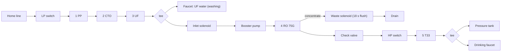
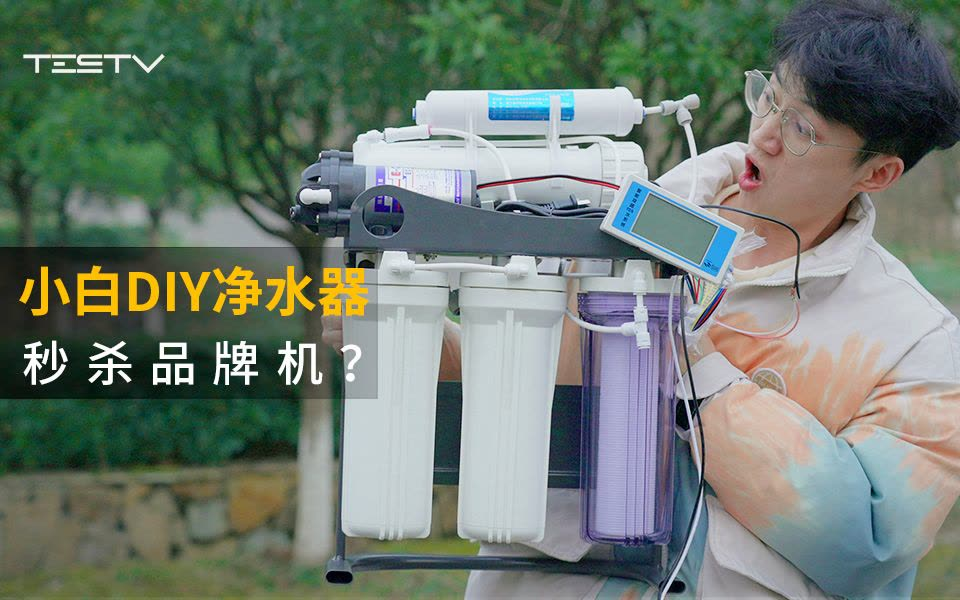

# 03 · BV1ao4y1W7J7: TESTV "Beginner DIY purifier vs brand machines"

## 1. Metadata

| Field | Value |
|---|---|
| Title (zh) | 小白DIY净水器，秒杀品牌机？【BB Time第394期】 |
| Title (en) | "A total beginner DIYs a water purifier: does it beat brand machines? [BB Time #394]" |
| Uploader | TESTV官方频道 |
| Link | https://www.bilibili.com/video/BV1ao4y1W7J7 |
| Plays | 376,421 (Bilibili search API, 2026-10-18) |
| Published | 2023-03-30 |
| Duration | 21:19 |

**Sources used:** search-API metadata and description; a re-transcription of the audio saved by the earlier run (faster-whisper `small` with VAD; **approximate**); the video cover. Comments couldn't be fetched (HTTP 412).

Description: building a 5-stage purifier because brand filters are expensive; "the office almost flooded and I got soaked".

## 2. Architecture

**From auto-transcript, approximate**, plus the cover:

- Scheme: **5-stage, with tank, dual outlet** (the transcript reads "5G油桶双出水", most likely 五级有桶双出水; the RO is later called **75G**). He drew a diagram of the water path and the electronics (shown at about 00:49; not captured).
- **Inlet:** **low-pressure switch** at the front ("protects the system when the water supply cuts out; recommended if your building pressure is low or the supply often cuts out"). Final hookup to the home line was done off-camera; the exact inlet method isn't stated.
- **Stage 1 PP → Stage 2 CTO carbon → Stage 3 UF.**
- **Tee after stage 3:** one branch goes straight to a faucet (UF water for washing produce), the other to the RO.
- **RO branch:** inlet solenoid valve → **booster pump** → **RO 75G** → product water through a **check valve** ("protects the RO from backflow") → **high-pressure switch** → **Stage 5 T33** → tee → **pressure tank** + drinking faucet.
- **Waste:** RO concentrate → **waste solenoid valve with an 18-second flush timer**. He first mixed it up with the inlet solenoid because they look alike; check the label.
- **Gauges/monitoring:** a pressure gauge was added. The cover shows a separate digital TDS meter display.
- **Electronics:** a control board that alerts on faults or water-quality issues (no detail).
- **Frame:** metal hanging rack (cover). In the final layout, the valves and pump moved to the back for a cleaner front.
- **Leak protection:** **none**. He lists this as a shortcoming in the summary.
- **UV / heating:** not mentioned.
- **Result:** TDS 13 versus 27 for the office Xiaomi purifier (the transcript adds that TDS < 50 is fine for drinking water; that's his claim, no basis given). Direct flow from the RO is slow; drawing from the pressure tank is about as fast as the Xiaomi. He concludes "75G + pressure tank is enough for a household".

*The position of the HP switch relative to T33 and the tank tee is approximate. The transcript is ambiguous ("the HP switch connects to the RO, then to the T33… this side goes to the pressure tank").*

## 3. Tags

| Dimension | Finding |
|---|---|
| Inlet method | Home line with an LP switch (exact tee not shown in the transcript) |
| Filter stages | PP → CTO → UF → RO 75G → T33 (UF side outlet) |
| RO membrane & pump | 75G with a booster pump |
| Storage | Pressure tank |
| Water safety | TDS check only |
| Sterilization (UV) | Not mentioned |
| Heating | Not mentioned |
| Leak/flood protection | None (admitted shortcoming) |
| Structure & portability | Open metal hanging rack |
| Electronics & smart | Control board, TDS meter display, pressure gauge, HP/LP switches |
| Brands | Not mentioned |
| Cost (BOM) | Says the whole build cost "over ¥1000", partly wasted buying the wrong quantities (from auto-transcript, approximate) |
| Maintenance | Flush new filters (about 30 min) before use |

## 4. BOM

No BOM in the description. Comments not accessible this run.

## 5. Problems / pitfalls raised

| Problem | Solution mentioned? |
|---|---|
| Threaded joints leaked on first fill and flooded the office | Yes: re-wrap all threads with enough PTFE tape |
| No water out, and the inlet solenoid got hot | Yes: a stage-3 cartridge was installed backwards (seller diagnosed it) |
| Inlet and waste solenoids look identical | Yes: read the label. The waste one has an 18 s flush timer |
| Over-tightening plastic elbows breaks them | Yes: don't use excessive force |
| Slow direct RO flow | Yes: use a pressure tank |
| No leak protection | No, listed as a to-do |
| Bought the wrong part quantities | No, a lesson learned |

## 6. Architecture screenshots

In-video frames couldn't be extracted (Bilibili HTTP 412). This is the **video cover**, uploader-made, not an in-video frame:

*Cover: an open metal rack with 3 × 10" housings (the third is transparent), a booster pump and membrane housing on top, an inline cartridge, and a digital TDS meter.*
