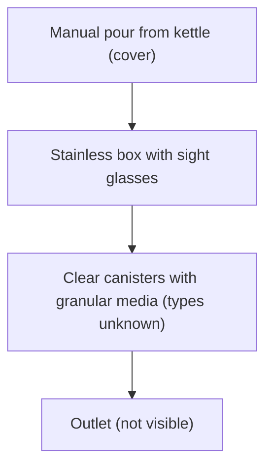

# 04 · BV1nGUYY9ES7: 帅农鸟哥 "A homemade purifier to impress my wife"

## 1. Metadata

| Field | Value |
|---|---|
| Title (zh) | 我老婆老说，我做的东西她用不到！今天做一个净水器，给她一点小小的震撼！ |
| Title (en) | "My wife says she never gets to use what I make! Today I'm building a water purifier to give her a little shock!" |
| Uploader | 帅农鸟哥 |
| Link | https://www.bilibili.com/video/BV1nGUYY9ES7 |
| Plays | 267,606 (Bilibili search API, 2026-10-18) |
| Published | 2024-11-16 |
| Duration | 9:36 |

**Data limits for this video:** Bilibili returned HTTP 412 to this box before the video, its comments, or its audio could be fetched, and per the rate-limit rule Bilibili access was stopped. Only the search-API metadata/description (fetched before the block), the BiliPlus mirror metadata, and the uploader cover image (via the BiliPlus image mirror) were available. **Nothing below comes from watching the video.**

Description: "有炉，有净水器，平常泡茶就方便多了！" (With a stove and a purifier, making tea is much more convenient.)

## 2. Architecture (cover only, unverified)

The cover shows a **stainless-steel box** with round sight-glass windows on the sides. Water is **poured in by hand from a kettle** into a top inlet. Below the box sit several **clear canisters filled with granular media**, framed in stainless rods, and a hose and black bulb hang from the side. This suggests a **manual-fill, gravity or low-pressure media filter**, not an RO system. The media types, stage order, and whether any membrane or pump is involved **can't be verified**.

## 3. Tags

| Dimension | Finding |
|---|---|
| Inlet method | Manual pour (cover) |
| Filter stages | Granular-media canisters (count and types unverified) |
| RO membrane & pump | No evidence of RO (unverified) |
| Storage | Not verifiable |
| Water safety | Not verifiable |
| Sterilization (UV) | Not mentioned |
| Heating | Not mentioned (the description mentions a stove for tea) |
| Leak/flood protection | Not mentioned |
| Structure & portability | Custom stainless enclosure (cover) |
| Electronics & smart | Not verifiable |
| Brands | Not mentioned |
| Cost (BOM) | Not available |
| Maintenance | Not available |

## 4. BOM

Not available.

## 5. Problems / pitfalls

Not available (comments not fetched).

## 6. Architecture screenshots

Cover image (not an in-video frame):

*Cover: a stainless box with sight glasses, manual pour-in, and media canisters underneath.*

> Relevance note: kept because it's an adult maker building a household drinking-water purifier, but it appears to be a non-RO showpiece build. It has low relevance to the project goals (direct-connect RO).
