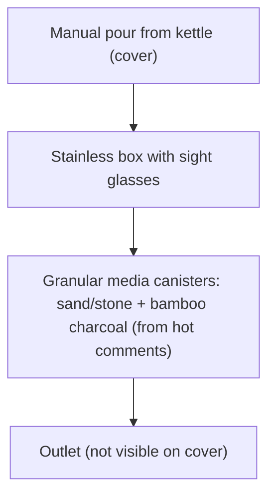
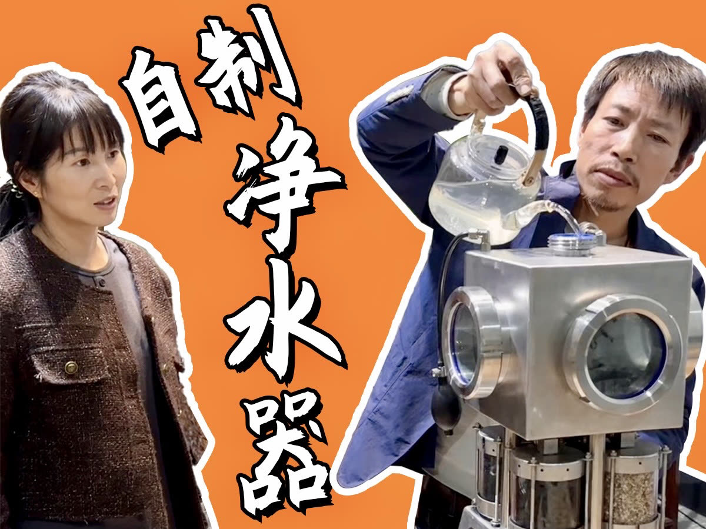

# 04 · BV1nGUYY9ES7: 帅农鸟哥 "A homemade purifier to impress my wife"

## 1. Metadata

| Field | Value |
|---|---|
| Title (zh) | 我老婆老说，我做的东西她用不到！今天做一个净水器，给她一点小小的震撼！ |
| Title (en) | "My wife says she never gets to use what I make! Today I'm building a water purifier to give her a little shock!" |
| Uploader | 帅农鸟哥 |
| Link | https://www.bilibili.com/video/BV1nGUYY9ES7 |
| Plays | 267,616 (Bilibili view API, 2026-10-19) |
| Published | 2024-11-16 |
| Duration | 9:36 |
| aid | 113491390240442 |

**Sources used this run (2026-10-19 ~11:11 Asia/Shanghai):** anonymous `x/web-interface/view` API (HTTP 200) for metadata/description; anonymous `x/v2/reply/main` (HTTP 200) for pinned + hot comments (two pages). **Video download was not completed:** yt-dlp webpage fetch returned **HTTP 412**, so per the rate-limit rule this run stopped all further Bilibili access and **no in-video frames were extracted**. Architecture below combines the uploader cover (prior run), the description, and comment text. **Nothing below comes from watching the video.**

Description: "有炉，有净水器，平常泡茶就方便多了！" (With a stove and a purifier, making tea is much more convenient.)

## 2. Architecture (cover + comments; video not watched)

The cover shows a **stainless-steel box** with round sight-glass windows. Water is **poured in by hand from a kettle** into a top inlet. Below the box sit several **clear canisters filled with granular media**, framed in stainless rods. Comments (hot) identify the media as **sand/stone (砂石 / 石英石沙) and bamboo charcoal (竹炭)** — a **manual-fill, gravity / multi-media filter**, not an RO system. There is **no evidence of an RO membrane or booster pump** in the cover or in the comment discussion.

Commenters treat it as a craft multi-media filter (some compare it to aquarium filtration) and note it **cannot lower TDS or soften water** without an RO membrane.

*Membrane/pump stages are omitted because neither the cover nor the fetched comments support them. Not verified against the video.*

## 3. Tags

| Dimension | Finding |
|---|---|
| Inlet method | Manual pour (cover) |
| Filter stages | Sand/stone + bamboo charcoal canisters (hot comments); count/order not verified from video |
| RO membrane & pump | No evidence of RO (cover + comments explicitly contrast with RO) |
| Storage | Not verifiable |
| Water safety | Commenters: media alone does not make water safe to drink as pure water; not RO |
| Sterilization (UV) | Not mentioned |
| Heating | Not mentioned (description mentions a stove for tea) |
| Leak/flood protection | Not mentioned |
| Structure & portability | Custom stainless enclosure; commenters note media chambers appear welded shut (hard to service) |
| Electronics & smart | None apparent |
| Brands | Not mentioned |
| Cost (BOM) | Not available (pinned comment is a tea-shop promo, not a BOM) |
| Maintenance | Hot comments: sand/charcoal are consumables and need periodic replacement; welded layout makes that hard |

## 4. BOM

No itemized BOM. The uploader's **pinned comment** is a **Longjing tea shop promo** (b23.tv mall link + ¥10 coupon), not a parts list.

## 5. Problems / pitfalls raised

| Problem | Source | Solution mentioned? |
|---|---|---|
| Sand/stone and bamboo charcoal are consumables; welding the canisters shut makes replacement hard | Hot comment (@浪里白条高约翰, 208 likes) | Partial: add filter paper/gauze between vessels; still says filtered raw water shouldn't be drunk as-is |
| Only bamboo charcoal does useful adsorption; sand/stone is mostly decorative or even counterproductive | Hot comment (@在浙赣, 162 likes) | Yes (suggested): buy real filter cartridges, or replace sand with clay/ceramic beads / stainless beads for some adsorption/sterilization — **unverified advice** |
| Sand + carbon cannot remove TDS or soften water; RO membrane isn't handmade | Hot comment (@淡定的小歪, 31 likes) | No (states the limitation) |
| Compared to aquarium multi-media filtration (joke / alternate use) | Hot comment (@超级糊涂家, 214 likes) | n/a |
| Pinned "BOM" is actually a tea promo | Pinned (@帅农鸟哥) | n/a |

## 6. Architecture screenshots

Cover image only (no in-video frames this run — download blocked by HTTP 412):

*Cover: a stainless box with sight glasses, manual pour-in, and media canisters underneath.*

> Relevance note: adult maker building a household drinking-water device, but it is a **non-RO gravity / multi-media showpiece**. Low relevance to direct-connect RO project goals.
