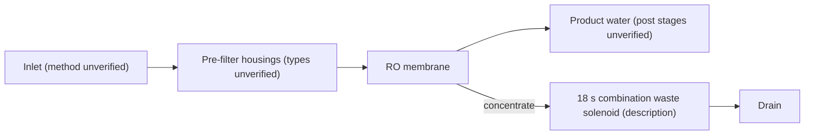

# 05 · BV1RhPCeLEHP: 西安无忧水务净水 "How easy is it to assemble a purifier yourself"

## 1. Metadata

| Field | Value |
|---|---|
| Title (zh) | 自己动手攒一台净水器有多简单 |
| Title (en) | "How simple is it to put together a water purifier yourself" |
| Uploader | 西安无忧水务净水 (a Xi'an water-treatment business) |
| Link | https://www.bilibili.com/video/BV1RhPCeLEHP |
| Plays | 239,912 (Bilibili search API, 2026-10-18) |
| Published | 2025-02-12 |
| Duration | 3:05 |

**Data limits for this video:** Bilibili returned HTTP 412 to this box before the video, its comments, or its audio could be fetched, and per the rate-limit rule Bilibili access was stopped. Only the search-API metadata/description (fetched before the block), the BiliPlus mirror metadata, and the uploader cover image (via the BiliPlus image mirror) were available. **Nothing below comes from watching the video.**

Description (full): "自己动手攒一台净水器有多简单 / 置顶评论非常重要，一定要看 / PS:兄弟们，废水电磁阀一定要换成18S组合废水电磁阀啊.就这样的。"
→ "The pinned comment is very important, be sure to read it. PS: guys, you must swap the waste-water solenoid for an **18 s combination waste-water solenoid valve**."

## 2. Architecture (very limited)

- The cover shows white filter housings (one labeled 进水 / inlet, one with a FLOW arrow) next to a **blue RO membrane** (unwrapped), with a ¥100 banknote for scale or price. This suggests an RO build with generic housings. Stage list, pump, and storage **unverified**.
- **Waste-water control:** the uploader insists on an **18-second combination waste solenoid** (a timed-flush waste valve; same concept as video 03).
- The pinned comment ("very important") **couldn't be read**.

## 3. Tags

| Dimension | Finding |
|---|---|
| Inlet method | Not verifiable |
| Filter stages | Housings + RO (cover). Details unverified |
| RO membrane & pump | RO membrane visible. Flux and pump unknown |
| Storage | Not verifiable |
| Water safety | Not verifiable |
| Sterilization (UV) | Not mentioned |
| Heating | Not mentioned |
| Leak/flood protection | Not mentioned |
| Structure & portability | Not verifiable |
| Electronics & smart | 18 s combination waste solenoid (description) |
| Brands | Not mentioned |
| Cost (BOM) | A ¥100 note on the cover (price implication not verified) |
| Maintenance | Not available |

## 4. BOM

The pinned comment probably holds it ("must read"), but it **couldn't be fetched**.

## 5. Problems / pitfalls

| Problem | Source | Solution mentioned? |
|---|---|---|
| The wrong waste solenoid type is used | Description | Yes: use the 18 s combination waste solenoid |

## 6. Architecture screenshots

**No screenshot available.** The video couldn't be downloaded (HTTP 412), and the cover is a close-up of housings plus a banknote that doesn't show the architecture.
