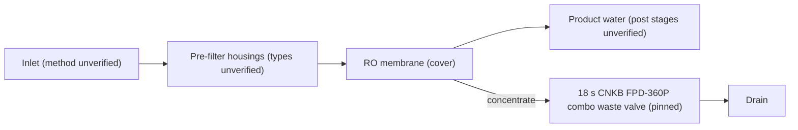
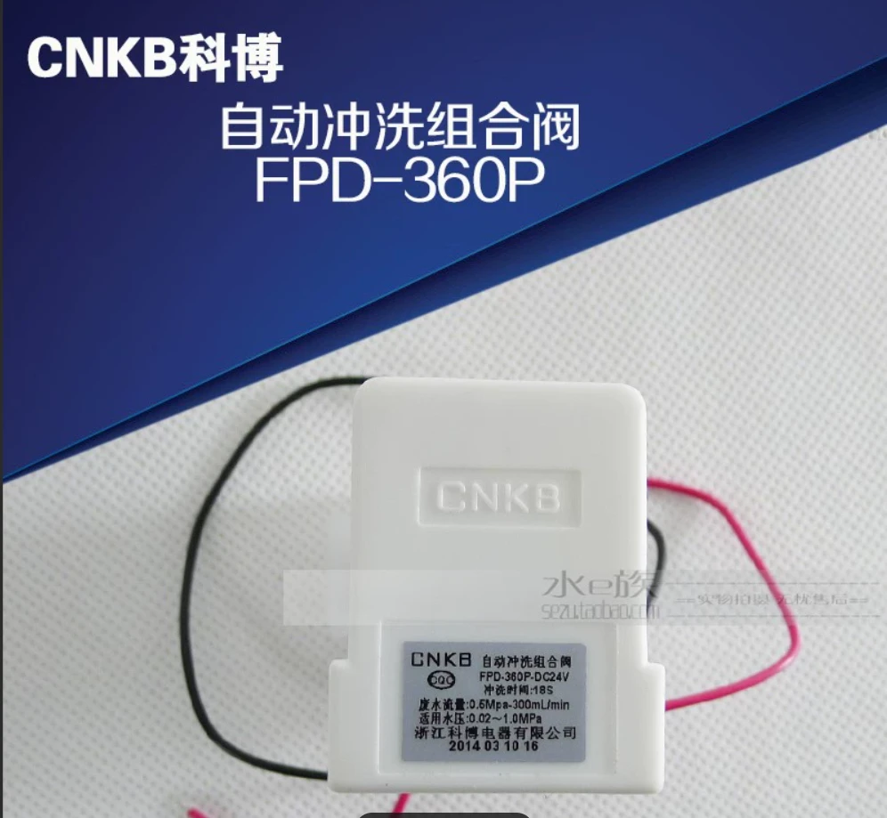

# 05 · BV1RhPCeLEHP: 西安无忧水务净水 "How easy is it to assemble a purifier yourself"

## 1. Metadata

| Field | Value |
|---|---|
| Title (zh) | 自己动手攒一台净水器有多简单 |
| Title (en) | "How simple is it to put together a water purifier yourself" |
| Uploader | 西安无忧水务净水 (a Xi'an water-treatment business) |
| Link | https://www.bilibili.com/video/BV1RhPCeLEHP |
| Plays | 239,945 (Bilibili view API, 2026-10-19) |
| Published | 2025-02-12 |
| Duration | 3:05 |
| aid | 113948955251689 |

**Sources used this run (2026-10-19 ~12:08 Asia/Shanghai):** anonymous `x/web-interface/view` API (HTTP 200) for metadata/description; anonymous `x/v2/reply` + `x/v2/reply/reply` (HTTP 200) for the uploader **pinned** comment (with product photo) and its child thread, plus a few hot comments. **Video download was not completed:** yt-dlp webpage fetch returned **HTTP 412**, so per the rate-limit rule this run stopped all further Bilibili access and **no in-video frames were extracted**. Architecture below combines the description, the pinned comment + photo, and hot/child comments. **Nothing below comes from watching the video.**

Description (full): "自己动手攒一台净水器有多简单 / 置顶评论非常重要，一定要看 / PS:兄弟们，废水电磁阀一定要换成18S组合废水电磁阀啊.就这样的。"
→ "The pinned comment is very important, be sure to read it. PS: guys, you must swap the waste-water solenoid for an **18 s combination waste-water solenoid valve**."

## 2. Architecture (description + comments; video not watched)

- Stage list, pump, tank, and layout **unverified** (video not watched). The cover (prior survey) showed white filter housings next to a blue RO membrane and a ¥100 banknote; that only supports "housings + RO", not a full chain.
- **Waste-water control (verified from description + pinned comment):** the uploader insists on replacing a plain waste solenoid with an **18-second automatic-flush combination waste valve**. The pinned comment attaches a product photo of a **CNKB 科博 FPD-360P-DC24V** 「自动冲洗组合阀」 (automatic flush combination valve): label reads flush time **18S**, waste flow **0.6 MPa – 300 mL/min**, applicable pressure **0.02–1.0 MPa**, **DC 24 V**, maker 浙江科博电器. Child comments report that with the original valve some builds only dump concentrate and produce **no pure water**; after swapping to this 18 s combo valve and powering on (wait a bit), pure water appears alongside waste.
- No itemized BOM was in the current pinned text (only the valve warning + photo). Hot comments discuss cost anecdotes, not a parts list.

*Pump, tank, post-carbon, and switches omitted because they were not verified from API/comment sources.*

## 3. Tags

| Dimension | Finding |
|---|---|
| Inlet method | Not verifiable |
| Filter stages | Housings + RO (cover from prior survey). Details unverified |
| RO membrane & pump | RO membrane on cover. Flux and pump unknown |
| Storage | Not verifiable |
| Water safety | Not verifiable from video; one hot comment claims DIY with brand filters held TDS ≈ 6 for 3 years (anecdote, not measured here) |
| Sterilization (UV) | Not mentioned |
| Heating | Not mentioned |
| Leak/flood protection | Not mentioned |
| Structure & portability | Not verifiable |
| Electronics & smart | **18 s automatic-flush combination waste valve**, CNKB FPD-360P-DC24V (pinned photo) |
| Brands | Waste valve: CNKB / 科博 (pinned). Hot comments mention 沁园 (bought brand unit) and generic 公模 shells |
| Cost (BOM) | No itemized BOM. Hot anecdotes: brand unit ~¥1000 vs DIY shell+filters "at most ¥300"; another DIY ~¥600+ with brand filters |
| Maintenance | Child comments: wrong waste valve → no pure water; swap to 18 s combo valve |

## 4. BOM

No itemized parts list in the pinned comment or the hot comments fetched. The only concrete part identified is the **recommended waste valve**:

| Part | Spec (from pinned photo label) | Source |
|---|---|---|
| Automatic flush combination waste valve | CNKB FPD-360P-DC24V; 18 s flush; waste ~300 mL/min @ 0.6 MPa; 0.02–1.0 MPa; DC 24 V | Uploader pinned comment + attached product photo |

Child comment: 3/8″ tubing can use a 3→2 adapter into a 1/4″ combo waste valve (uploader replied that waste-side adapters are fine).

## 5. Problems / pitfalls

| Problem | Source | Solution mentioned? |
|---|---|---|
| Wrong / non-combo waste solenoid → only waste flows, **no pure water** | Description; pinned; child thread (@Sunshine刺眼-, @狙击超大, @爱吃呆鱼笑) | **Yes:** replace with **18 s automatic-flush combination waste valve** (CNKB FPD-360P shown); power on and wait; route waste to drain |
| Can't find a 3/8″ combo waste valve | Child (@葬草埋花) | **Yes (uploader):** use 3→2 adapter; waste side can be adapted |
| Brand under-sink unit feels like overpaying vs DIY shell + filters | Hot (@燃烧的比卡丘) | Anecdote only (¥1000 沁园 vs ≤¥300 DIY) |
| Want a ready kit / seller assembly | Hot + child | Uploader is a Xi'an water business; commenters ask for packages — **not verified as a public kit listing** |

## 6. Architecture screenshots

**No in-video frames** (yt-dlp webpage → HTTP 412; run stopped). Comment-sourced product photo of the recommended waste valve:

*Pinned comment image: CNKB 科博 FPD-360P-DC24V automatic flush combination valve (18 s), not an in-video architecture frame.*
