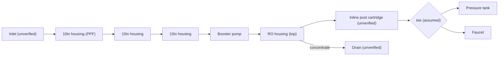

# 07 · BV1M24y1a7Nk: Michael_8396 "Spent ¥500 and DIY'd an RO purifier"

## 1. Metadata

| Field | Value |
|---|---|
| Title (zh) | 花了500，我DIY了一台反渗透式净水器 |
| Title (en) | "Spent ¥500, I DIY'd a reverse-osmosis water purifier" |
| Uploader | Michael_8396 |
| Link | https://www.bilibili.com/video/BV1M24y1a7Nk |
| Plays | 176,831 (Bilibili search API, 2026-10-18) |
| Published | 2023-01-20 |
| Duration | 5:16 |

**Data limits for this video:** Bilibili returned HTTP 412 to this box before the video, its comments, or its audio could be fetched, and per the rate-limit rule Bilibili access was stopped. Only the search-API metadata/description (fetched before the block), the BiliPlus mirror metadata, and the uploader cover image (via the BiliPlus image mirror) were available. **Nothing below comes from watching the video.** The audio saved by the earlier run was transcribed again with VAD this run, but it produced **no speech** (the earlier run's attempts produced only noise tokens). The video appears to be music-only or captioned.

Description: "Family said the new home needs a purifier, so I wondered if I could build one, mainly to save money; a decent RO purifier costs close to or over ¥1000."

## 2. Architecture (cover only, unverified)

Visible on the cover (an assembled unit on a windowsill):
- **Three 10" pre-filter housings** under a white hanging plate. One cartridge label reads "PPF".
- On top of the plate: a horizontal **membrane housing** and **inline cartridges** (most likely RO + post-carbon, unverified), with a **booster pump** (black, left).
- A **purifier control board with a display** strapped across the inline cartridges. Its icons read 冲洗 (flush), 缺水 (no water), 水满 (tank full), 检修 (service), 制水 (producing).
- A white **pressure tank** with a blue ball valve beside the unit. A 24 V-style power brick sits on the table.
- Leak protection, UV, heating: nothing visible.

*The order and connections are the standard RO layout matching the parts visible on the cover. They are **not verified** against the video.*

## 3. Tags

| Dimension | Finding |
|---|---|
| Inlet method | Not verifiable |
| Filter stages | 3 × 10" pre + inline RO + inline post (cover, unverified) |
| RO membrane & pump | Booster pump visible. Flux unknown |
| Storage | Pressure tank (cover) |
| Water safety | Not verifiable |
| Sterilization (UV) | None visible |
| Heating | None visible |
| Leak/flood protection | None visible |
| Structure & portability | Open hanging plate |
| Electronics & smart | Control board with status display (flush / no water / full / service / producing) |
| Brands | Not verifiable |
| Cost (BOM) | About ¥500 (title) |
| Maintenance | Not available |

## 4. BOM

The earlier research run reported that the uploader **pinned a BOM comment**, but its text wasn't saved, and it **couldn't be fetched** this run (HTTP 412). Only the total "¥500" (title) is known.

## 5. Problems / pitfalls

Not available (comments not fetched, no speech in the audio).

## 6. Architecture screenshots

Cover image (not an in-video frame):

*Cover: 3 × 10" housings, a top-mounted membrane housing and inline cartridges, a control board with a status display, the pump, and a pressure tank.*
