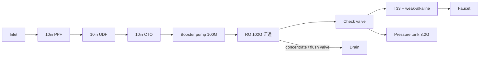
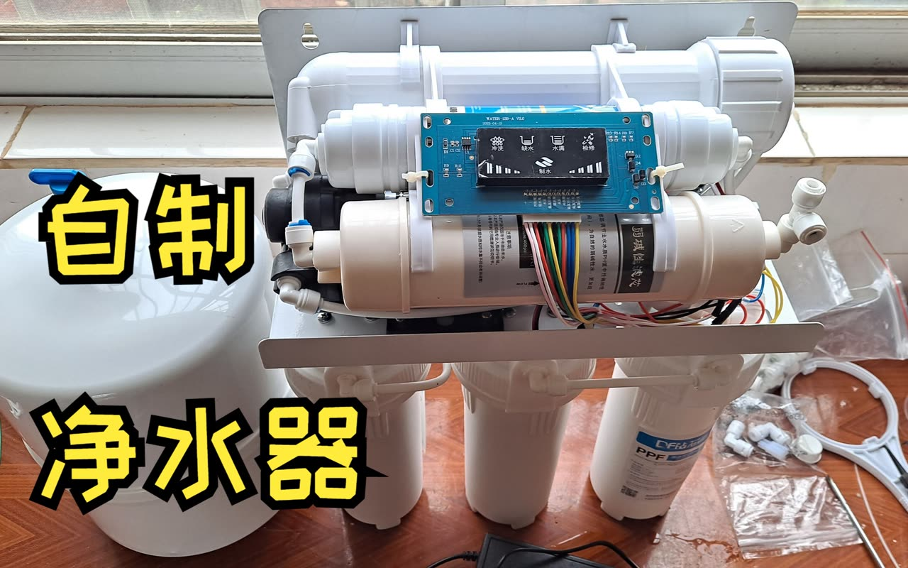

# 07 · BV1M24y1a7Nk: Michael_8396 "Spent ¥500 and DIY'd an RO purifier"

## 1. Metadata

| Field | Value |
|---|---|
| Title (zh) | 花了500，我DIY了一台反渗透式净水器 |
| Title (en) | "Spent ¥500, I DIY'd a reverse-osmosis water purifier" |
| Uploader | Michael_8396 |
| Link | https://www.bilibili.com/video/BV1M24y1a7Nk |
| Plays | 176,918 (Bilibili view API, 2026-10-20) |
| Published | 2023-01-20 |
| Duration | 5:16 |
| aid | 693061800 |

**Sources used this run (2026-10-20 ~20:04 Asia/Shanghai):** anonymous `x/web-interface/view` API (HTTP 200) for metadata; anonymous `x/v2/reply/main` + `x/v2/reply/reply` (HTTP 200) for the uploader **pinned BOM** and hot/child threads. **Nothing below comes from watching the video.** No yt-dlp / in-video frames this pass (Phase A). Cover from the prior survey remains cover-only evidence.

Description: "听家人说新房子要装一台净水器，就寻思能不能自己做一台关键还能省钱哈哈哈，毕竟质量好些的反渗透型净水器接近一千或上千块" (family wanted a purifier for the new home; DIY to save money vs ~¥1000+ brand RO).

## 2. Architecture (pinned BOM + cover; video not watched)

Uploader-pinned parts list (same comment also in top_replies) defines a **100G tanked RO** on a hanging plate. Stages named in the pin:

- **Pre-filters:** 3 × 10" housings with **PPF → UDF → CTO**
- **RO:** **100G** membrane + housing; brand used by uploader: **汇通** (also names **陶氏/DuPont** as a pricier option)
- **Post:** **T33** carbon stick + **弱碱性滤芯** (weak-alkaline / mineralizing)
- **Hydraulics / electrics:** **100G** booster pump, **电脑板** (control board; pin writes “电脑版”), **24 V 3 A** PSU, **高压开关**, **低压开关**, **冲洗阀**, **进水阀**, faucet, **3.2 G** pressure tank, hanging plate
- Fittings listed: 2-分 pure-water tee valve, 2-分 in-line check, tees / side-tees, male-thread elbows for housings, quick-connect elbows, 10 m of 2-分 PE tube

Cover (prior survey, not re-fetched): assembled hanging-plate unit with status board icons 冲洗 / 缺水 / 水满 / 检修 / 制水, pump, pressure tank — consistent with the pin.

*Stage names and 100G / tank size come from the uploader pin. Exact tee order relative to tank vs post-carbon is the usual tanked layout and is **not** spelled out as a sequence in the pin; treat the tank branch as schematic.*

## 3. Tags

| Dimension | Finding |
|---|---|
| Inlet method | Not verifiable from API text (pin lists 进水阀 + hanging-plate install) |
| Filter stages | PPF → UDF → CTO → RO 100G → T33 → 弱碱性 (pinned) |
| RO membrane & pump | 100G RO (汇通 used; 陶氏 named as alternative) + 100G booster (pinned) |
| Storage | Pressure tank **3.2 G** (pinned) |
| Water safety | Hot: small-flux / 50G builds claim low stale-water; pin does not claim 零陈水 |
| Sterilization (UV) | Not mentioned |
| Heating | Not mentioned |
| Leak/flood protection | Not in uploader pin; one hot commenter adds a leak valve on a *different* factory-mod BOM (anecdote) |
| Structure & portability | Open hanging plate (pin + prior cover) |
| Electronics & smart | Control board + LPS/HPS + flush/inlet valves + 24 V 3 A (pinned); cover status icons |
| Brands | RO: **汇通** (used), **陶氏** (named). Hot brand tips: 三角洲/邓元/柏繁 pumps; NSF housings; CCK tubing (commenter tips, not uploader pin) |
| Cost (BOM) | Title ¥500; pin: **¥400–500** for parts used (extra joints/spares). Hot: TB kits ~¥300–400; brand filter lock-in anecdotes |
| Maintenance | Hot: prefer NSF housings / quick-connect later; proprietary brand cartridges expensive (美的 peanut anecdote) |

## 4. BOM

Uploader **pinned** itemized list (recorded as seen):

| Item | Qty / note | Role | Source |
|---|---|---|---|
| 10" filter housing | ×3 | Pre-filter vessels | Uploader pinned |
| PPF | ×1 | Sediment pre | Uploader pinned |
| UDF | ×1 | Granular carbon pre | Uploader pinned |
| CTO | ×1 | Compressed carbon pre | Uploader pinned |
| RO membrane + housing | ×1, **100G** | Core RO (汇通 used) | Uploader pinned |
| T33 carbon stick | ×1 | Post-carbon | Uploader pinned |
| 弱碱性滤芯 | ×1 | Post mineralizing / alkaline | Uploader pinned |
| Hanging plate | ×1 | Mount | Uploader pinned |
| Pressure tank | **3.2 G** ×1 | Storage | Uploader pinned |
| Booster pump | ×1, **100G** | Feed pressure | Uploader pinned |
| Control board (“电脑版”) | ×1 | Controller | Uploader pinned |
| 24 V 3 A PSU | ×1 | Power | Uploader pinned |
| High-pressure switch | ×1 | Tank-full cutout | Uploader pinned |
| Low-pressure switch | ×1 | Dry-run protect | Uploader pinned |
| Flush valve | ×1 | RO flush / waste | Uploader pinned |
| Inlet valve (solenoid) | ×1 | Feed cut | Uploader pinned |
| Faucet | ×1 | Pure outlet | Uploader pinned |
| 2-分 fittings + 10 m PE | as listed in pin | Plumbing | Uploader pinned |

Pin note: install cost **¥400–500**; core is the RO membrane; buy cheap fittings OK; TB pre-built machines ~¥300–400 exist but filter quality unknown.

## 5. Problems / pitfalls

| Problem | Source | Solution mentioned? |
|---|---|---|
| Brand machines: proprietary cartridges ~¥800 / 2 yrs (美的 peanut) | Hot (@VIP-永恒) | **Framed:** DIY / universal path avoids lock-in |
| Cheap TB RO desalination only ~80% | Child under pin (@末夏の雨) | **Yes:** replace with 汇通 membrane (~¥200 in that anecdote) |
| 100G flux “too small” vs 400G+ | Child / hot | **Discussed:** with a tank, flux less critical (@鼗瓠蘤); larger flux needs matching pump + membrane (uploader) |
| Stale water in tank (陈水) | Child under pin | **Anecdote only:** small tank “not a big issue”; no verified zero-stale design here |
| DIY parts shopping vs ready kit price | Hot (@玉屏花开) | **Yes (for them):** bought finished machine cheaper than parts hunt; brand shops won’t swap pump |
| Wrong / mismatched pump–membrane–housing specs | Hot (@玉屏花开 self-reply tip list) | **Yes:** buy matching G ratings; NSF housings; named pump/RO brands |
| No waste/flush valve → no pure water (other builder) | Hot (@墨染丹青韵) | **Yes:** add waste valve; low mains pressure (0.1 MPa) needs a pump |
| Sweet taste expectation | Child under pin | **Yes (uploader):** comes from adding a mineralizing post filter, not from RO alone |

## 6. Architecture screenshots

**No in-video frames this pass.** Phase A uses view/reply APIs only; yt-dlp / webpage fetch is out of scope (prior runs hit HTTP 412 on webpage download). Cover from the prior survey:

*Cover: 3 × 10" housings, top-mounted membrane housing / inline cartridges, status-display board, pump, pressure tank — consistent with the pinned 100G BOM.*
