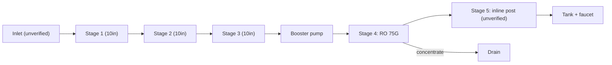

# 08 · BV1Re4y1r7mw: 不喝奶的鱼 "75G 5-stage purifier DIY tutorial"

## 1. Metadata

| Field | Value |
|---|---|
| Title (zh) | 75G五级净水器DIY教程丨全网首个手把手教你动手组装净水器的UP主~ |
| Title (en) | "75G 5-stage purifier DIY tutorial: the first uploader online to walk you step by step through assembling a purifier" |
| Uploader | 不喝奶的鱼 |
| Link | https://www.bilibili.com/video/BV1Re4y1r7mw |
| Plays | 164,927 (Bilibili search API, 2026-10-18) |
| Published | 2022-09-16 |
| Duration | 16:17 |

**Data limits for this video:** Bilibili returned HTTP 412 to this box before the video, its comments, or its audio could be fetched, and per the rate-limit rule Bilibili access was stopped. Only the search-API metadata/description (fetched before the block), the BiliPlus mirror metadata, and the uploader cover image (via the BiliPlus image mirror) were available. **Nothing below comes from watching the video.**

Description: "I explained the principle earlier (see video [20](20-BV1ri4y1k71v.md)); this time the assembly tutorial, very detailed; watch carefully and you can assemble it successfully."

## 2. Architecture (title and cover only)

- **Title:** a **5-stage** system with a **75G RO** membrane.
- **Cover** (parts laid out on the floor, "经典五级净水器DIY傻瓜式教程" / classic 5-stage foolproof tutorial): 3 × 10" housings, a white **pressure tank**, a **booster pump** with a power adapter, a control-board kit, a roll of tubing, the cartridges (a white PP-like one, a black carbon-block-like one, granular carbon, an inline RO membrane, and an inline post cartridge; cartridge types judged by appearance, **unverified**), two housing wrenches, and push-fit fittings and clips.

*Stage contents are unverified. Only "5-stage, 75G" (title) and the parts on the cover are confirmed.*

## 3. Tags

| Dimension | Finding |
|---|---|
| Inlet method | Not verifiable |
| Filter stages | 5 (title) |
| RO membrane & pump | 75G (title), booster pump (cover) |
| Storage | Pressure tank (cover) |
| Water safety | Not verifiable |
| Sterilization (UV) | Not mentioned |
| Heating | Not mentioned |
| Leak/flood protection | Not mentioned |
| Structure & portability | Not verifiable |
| Electronics & smart | Control-board kit visible (cover) |
| Brands | Not verifiable |
| Cost (BOM) | Not available |
| Maintenance | Not available |

## 4. BOM

Not available.

## 5. Problems / pitfalls

Not available.

## 6. Architecture screenshots

Cover image (not an in-video frame; low resolution as published):

*Cover: the full parts kit for a 5-stage pressure-tank RO.*
