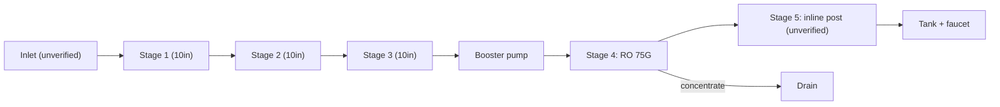
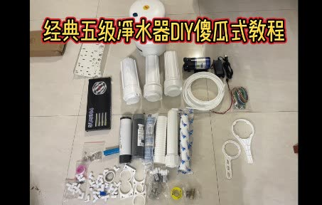

# 08 · BV1Re4y1r7mw: 不喝奶的鱼 "75G 5-stage purifier DIY tutorial"

## 1. Metadata

| Field | Value |
|---|---|
| Title (zh) | 75G五级净水器DIY教程丨全网首个手把手教你动手组装净水器的UP主~ |
| Title (en) | "75G 5-stage purifier DIY tutorial: the first uploader online to walk you step by step through assembling a purifier" |
| Uploader | 不喝奶的鱼 |
| Link | https://www.bilibili.com/video/BV1Re4y1r7mw |
| Plays | 165,012 (Bilibili view API, 2026-10-20) |
| Published | 2022-09-16 |
| Duration | 16:17 |
| aid | 558122825 |

**Sources used this run (2026-10-20 ~20:06 Asia/Shanghai):** anonymous `x/web-interface/view` API (HTTP 200) for metadata; anonymous `x/v2/reply/main` (HTTP 200) for pinned + hot comments. **Nothing below comes from watching the video.** No yt-dlp / in-video frames this pass (Phase A). Cover from the prior survey remains cover-only evidence.

Description: "前面讲解了净水器原理，这次分享组装教程，内容非常详细，仔细观看此视频，即可组装成功！有不懂得同学评论留言回复~" (principles covered earlier — see video [20](20-BV1ri4y1k71v.md); this is the assembly tutorial).

## 2. Architecture (title + cover + comments; video not watched)

- **Title / page part:** **5-stage**, **75G** RO DIY assembly tutorial.
- **Cover** (prior survey): parts kit — 3 × 10" housings, pressure tank, booster pump + adapter, control-board kit, tubing, cartridges, wrenches, push-fits. Cartridge types by appearance only (**unverified**).
- **Pinned comment:** points to a **粉丝交流群** (QQ `1145568775`) and says **配件已列入清单，群文件自行查看** — the itemized BOM is **not** in the public comment text. Child: also on 咸鱼 under the same nick.
- Hot comments discuss related DIY builds (100G minimal, 600G without board, PTFE tape on housings) but do **not** restate this video’s official stage list.

No mermaid upgrade: stage contents beyond “5-stage / 75G” are still **not** verifiable from API/comment text alone. Keep the prior schematic as cover/title-level only:

*Only “5-stage, 75G” (title) and parts on the cover are confirmed; order is the usual layout, not quoted from comments.*

## 3. Tags

| Dimension | Finding |
|---|---|
| Inlet method | Not verifiable |
| Filter stages | 5-stage (title). Contents unverified in API text |
| RO membrane & pump | 75G (title); booster + control kit (cover) |
| Storage | Pressure tank (cover) |
| Water safety | Hot anecdote: overnight TDS teens on a 125G build (@小四小哥) |
| Sterilization (UV) | Not mentioned |
| Heating | Not mentioned |
| Leak/flood protection | Not mentioned in pin/hot for this build |
| Structure & portability | Kit on floor (cover); structure unverified |
| Electronics & smart | Control-board kit (cover). Hot: without a board, valves/switches must be **series-wired** or they don’t act (@checkwhatsleft) |
| Brands | Uploader sells on 闲鱼 (pin child). Hot name-drops: 美硕 18 s flush, 科博 solenoids/switches (other builders) |
| Cost (BOM) | Not in public pin. Hot minimal estimate ~¥245–290 for a stripped 100G (@小乐趣闻); another bought 125G kit ~¥300+ |
| Maintenance | Hot debate on **生料带** vs gasket-only on housing threads |

## 4. BOM

**No public itemized BOM in the pinned comment.** Pin says the parts list is in the **QQ group file** (`1145568775`); also 咸鱼 same nick. Not fetched (would require joining the group).

Hot cost sketch (commenter’s own minimal 100G, **not** the uploader’s official list):

| Item (hot @小乐趣闻) | Approx. | Note |
|---|---|---|
| 10" housing + UF | ¥25 | Their minimal pre |
| Four solenoids | ¥50 | |
| CCK tubing | ¥10 | |
| Quick-fits + check | ¥20 | |
| RO housing + membrane + pump 100G | ~¥120 | |
| Control board + harness | ¥10 | |
| Dedicated faucet | ¥10 | |
| Optional pressure tank | ¥45 | Raises total ~¥290 |

Treat as **comment anecdote**, not this video’s BOM.

## 5. Problems / pitfalls

| Problem | Source | Solution mentioned? |
|---|---|---|
| Why PTFE tape if O-rings/gaskets exist? | Hot (@交易黑臼手) | **Uploader:** tape used to **orient** elbow direction after tightening. **Others:** with a gasket, skip tape — can crack plastic or prevent seating |
| No control board: LP switch doesn’t cut; faucet off but machine keeps running | Hot (@北川很菜_33) | **Yes:** wire switches/valves in a **series loop**; board normally handles that (@checkwhatsleft / @清水煮棒骨) |
| Brand “500G” unit opened → 300G motor inside | Hot (@风味发酵乳11) | **Discussed:** marketing G ratings unreliable; watch real flow / waste ratio |
| Where is the shopping list? | Hot (@飞鸟a游鱼) | **Pin:** QQ group file / 闲鱼; others say TB whole machines cost similar to DIY parts |
| Suggest jumping to 400G–800G | Hot (@小乐趣闻 / replies) | **Discussed:** tanked 75G can still have low stale TDS if pre-treatment is full 3-stage (@checkwhatsleft anecdote) |

## 6. Architecture screenshots

**No in-video frames this pass.** Phase A uses view/reply APIs only. Cover from the prior survey:

*Cover: full parts kit for a 5-stage pressure-tank RO (75G per title).*
