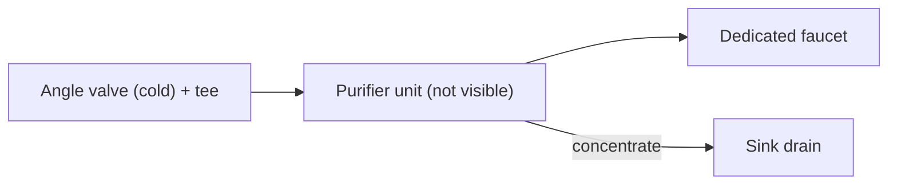
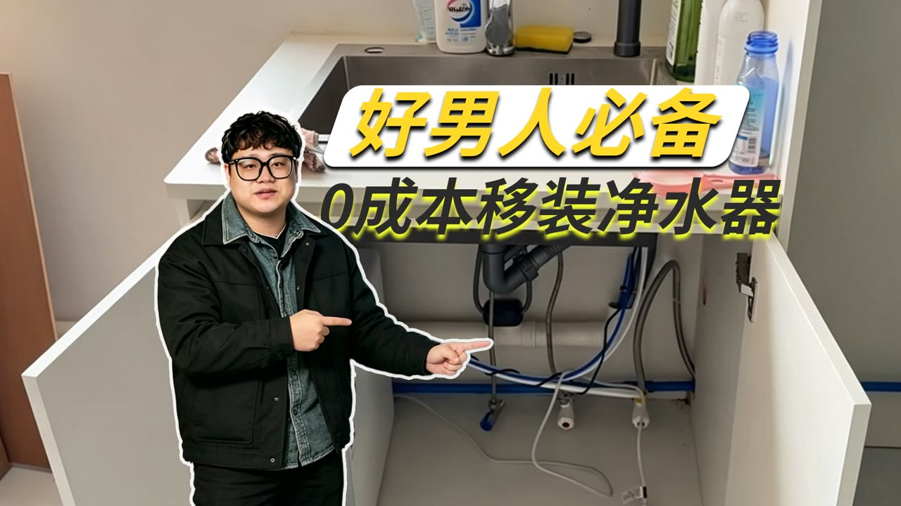

# 09 · BV1UuUKBnEAo: 甄莱斯 "Can you reinstall your purifier after moving?"

## 1. Metadata

| Field | Value |
|---|---|
| Title (zh) | 【vlog】净水器怎么自己安装？搬家拆机之后你还装的回去吗 |
| Title (en) | "[vlog] How to install a purifier yourself? After dismantling it to move house, can you put it back?" |
| Uploader | 甄莱斯 |
| Link | https://www.bilibili.com/video/BV1UuUKBnEAo |
| Plays | 150,163 (Bilibili view API, 2026-10-20) |
| Published | 2025-11-24 |
| Duration | 2:29 |
| aid | 115598289798634 |

**Sources used this run (2026-10-20 ~20:08 Asia/Shanghai):** anonymous `x/web-interface/view` API (HTTP 200) for metadata (page part: **「2号净水器移机更换」**); anonymous `x/v2/reply/main` (HTTP 200) for hot comments (no uploader pin). **Nothing below comes from watching the video.** No yt-dlp / in-video frames this pass (Phase A).

Description: "还有谁不会自己装净水器的？在线等"

**Why it matters for this project:** only top-20 entry focused on **re-installing after moving** (renter use case). Appears to relocate a pre-built / brand unit, not a DIY rack (**unverified** beyond title/cover/page part).

## 2. Architecture (cover + page title; video not watched)

- **Page part:** 「2号净水器移机更换」 — relocating / reinstalling unit #2.
- **Cover** (prior survey): under-sink cabinet — angle valves, dedicated faucet, blue/white tubing, drain trap. Unit stages **not** visible.
- Comments do not name filter stages, membrane size, or a DIY BOM. Brand names appear only as commenter questions (美的白泽 Max 1200G, 安吉尔, 九阳天净) — **not** confirmed as the unit in the vlog.

*Generic under-sink layout matching the cover. Not verified against the video.*

## 3. Tags

| Dimension | Finding |
|---|---|
| Inlet method | Angle valve under sink (cover) |
| Filter stages | Not mentioned in API/comments |
| RO membrane & pump | Not named for the vlog unit. Uploader reply cites 增压泵 mismatch as a noise cause (general) |
| Storage | Uploader reply mentions **压力桶** as a possible factor in pump noise (general tip) |
| Water safety | Not mentioned |
| Sterilization (UV) | Not mentioned |
| Heating | Not mentioned |
| Leak/flood protection | Not mentioned |
| Structure & portability | **Topic = move / reinstall** (title + page part). Hot: measure cabinet depth before buying (@啊伟你好骚) |
| Electronics & smart | Commenter asks about 美的白泽 touch faucet — unanswered usefully |
| Brands | Not confirmed for the filmed unit |
| Cost (BOM) | Cover slogan 「0成本移装」 — relocation labor/parts cost claim only |
| Maintenance | Hot: third-party filter substitutes requested; unanswered |

## 4. BOM

None. Relocation vlog; no parts list in pin (no pin) or hot text.

## 5. Problems / pitfalls

| Problem | Source | Solution mentioned? |
|---|---|---|
| Persistent **buzzing / humming** after install | Hot (@sevenyizhu000) | **Uploader guess:** missing/wrong **压力桶**, bad plumbing layout, or **增压泵** mismatch — call a tech |
| Installer damaged pipe | Hot (@吉英爱芷昂) | **Advice:** hire a reliable installer |
| Cabinet door won’t close (unit too deep) | Hot (@啊伟你好骚) | **Yes:** measure cabinet depth before purchase |
| Hard to mount when sink has a small window behind | Hot (@quwgvdshha) | **Advice:** site survey before install |
| Higher water bill after RO | Hot (@゙龙傲天) | **Speculated:** waste-water discharge (not measured) |
| Still need a separate countertop drinker? | Hot | **Uploader:** no — dedicated pure outlet is enough |

## 6. Architecture screenshots

**No in-video frames this pass.** Phase A uses view/reply APIs only. Cover from the prior survey:

*Cover: under-sink connection points (angle valves, tubing, drain) at the new home.*
