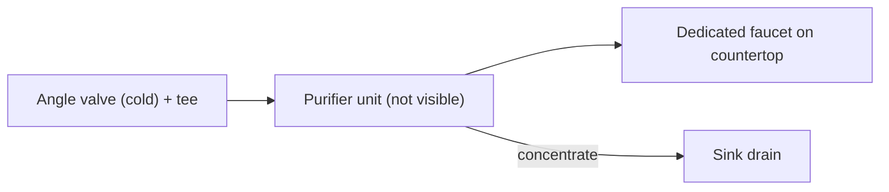

# 09 · BV1UuUKBnEAo: 甄莱斯 "Can you reinstall your purifier after moving?"

## 1. Metadata

| Field | Value |
|---|---|
| Title (zh) | 【vlog】净水器怎么自己安装？搬家拆机之后你还装的回去吗 |
| Title (en) | "[vlog] How to install a purifier yourself? After dismantling it to move house, can you put it back?" |
| Uploader | 甄莱斯 |
| Link | https://www.bilibili.com/video/BV1UuUKBnEAo |
| Plays | 150,154 (Bilibili search API, 2026-10-18) |
| Published | 2025-11-24 |
| Duration | 2:29 |

**Data limits for this video:** Bilibili returned HTTP 412 to this box before the video, its comments, or its audio could be fetched, and per the rate-limit rule Bilibili access was stopped. Only the search-API metadata/description (fetched before the block), the BiliPlus mirror metadata, and the uploader cover image (via the BiliPlus image mirror) were available. **Nothing below comes from watching the video.**

Description: "还有谁不会自己装净水器的？在线等" (Anyone else who can't install a purifier themselves? Waiting online.)

**Why it matters for this project:** it's the only top-20 video focused on **re-installing a purifier after moving**, which is exactly the renter use case.

## 2. Architecture (cover only)

The cover ("好男人必备 / 0成本移装净水器", must-have for good husbands: relocate a purifier at zero cost) shows the **under-sink cabinet** of the new home. Two angle valves sit on the wall with a white tube connected at one, there's a separate purifier faucet hole/tap on the counter, a **blue and a white tube** run along the cabinet back, plus the drain trap. The purifier unit itself and its stages aren't visible. It seems to be a brand or pre-built unit being relocated, not a DIY build (**unverified**).

*A generic layout matching the visible under-sink fittings. Not verified against the video.*

## 3. Tags

| Dimension | Finding |
|---|---|
| Inlet method | Angle valve under the sink (cover) |
| Filter stages | Not mentioned |
| RO membrane & pump | Not mentioned |
| Storage | Not mentioned |
| Water safety | Not mentioned |
| Sterilization (UV) | Not mentioned |
| Heating | Not mentioned |
| Leak/flood protection | Not mentioned |
| Structure & portability | **Topic is uninstall/reinstall when moving** (title). Details unverified |
| Electronics & smart | Not mentioned |
| Brands | Not mentioned |
| Cost (BOM) | "0成本" / zero cost relocation (cover slogan) |
| Maintenance | Not mentioned |

## 4. BOM

Not available.

## 5. Problems / pitfalls

| Problem | Source | Solution mentioned? |
|---|---|---|
| Can people reinstall a purifier themselves after moving? | Title | Implied yes (DIY relocation vlog); steps not verified |

## 6. Architecture screenshots

Cover image (not an in-video frame):

*Cover: the under-sink connection points (angle valves, tubing, drain) at the new home.*
