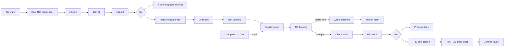
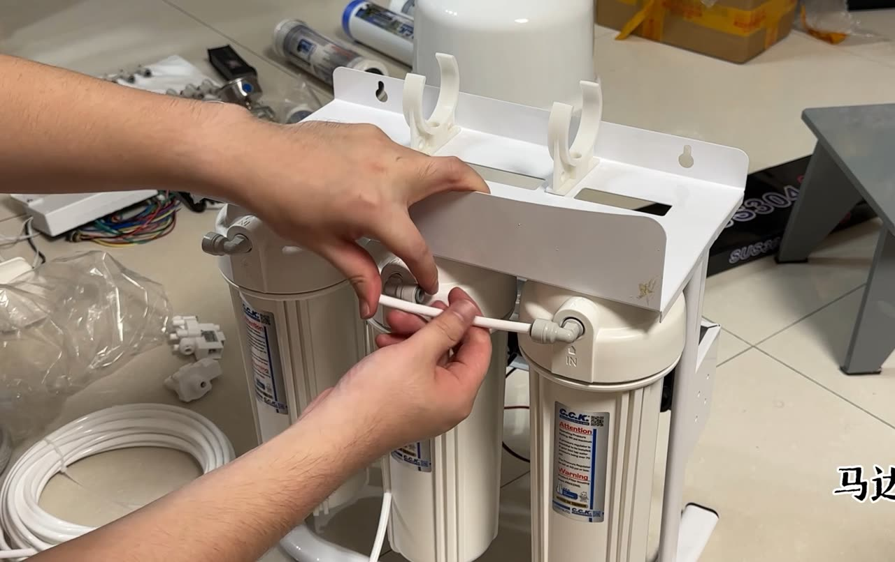

# 10 · BV1RMakeJE2n: 马达师 "Immersive DIY RO purifier build tutorial"

## 1. Metadata

| Field | Value |
|---|---|
| Title (zh) | 沉浸式DIY手搓RO反渗透净水器教程 |
| Title (en) | "Immersive DIY hand-built RO reverse-osmosis purifier tutorial" |
| Uploader | 马达师 |
| Link | https://www.bilibili.com/video/BV1RMakeJE2n |
| Plays | 141,242 (Bilibili search API, 2026-10-18) |
| Published | 2024-08-06 |
| Duration | 20:35 |

**Sources used:** search-API metadata and description; a re-transcription of the audio saved by the earlier run (faster-whisper `small` with VAD; **approximate**, but the narration is clear, including a full recap of the water path at 16:45–20:12); the cover. Comments couldn't be fetched (HTTP 412).

Description: he edited more than an hour of solo footage into 20 minutes; after watching "you'll understand how a purifier works and can secure safe water at low cost".

## 2. Architecture

From the uploader's own recap, **from auto-transcript, approximate**:

1. **Inlet:** tap water in, with a **raw-water TDS probe** (black lead) on a tee at the front. The final kitchen hookup (ball valve, drain) was "to be done later under the sink" and wasn't filmed.
2. **Stages 1–3:** three 10" housings in series (CCK brand visible on the cover). Cartridge types aren't named in the readable transcript.
3. **Tee after stage 3:** a side outlet to a separate **kitchen tap for pre-filtered water** (washing rice and vegetables).
4. **RO feed:** tee to a **pressure gauge** → **low-pressure switch** (single port, needs a tee; placed before the inlet solenoid) → **inlet solenoid valve** (arrow: top in, bottom out) → **booster pump**.
5. **RO housing:** two outlets, **pure** and **waste**. He stresses **never swap them**: waste water into the tank damages it, and "you'd drink water dirtier than tap water".
6. **Product line:** **check valve** (stops backflow into the RO) → **high-pressure switch** → tee to the **pressure tank** (single port, in and out) → **T33 post carbon** (taste) → tee with the **pure-water TDS probe** (white lead) → drinking faucet.
   - Key rule: **the pressure tank goes between the RO and the T33, never after the T33**, because carbon fines from the T33 would contaminate the tank.
7. **Waste:** RO waste port → **waste solenoid valve** → tube → kitchen drain pipe (a drain fitting was added).
8. **Electronics:** a control board with a color-coded harness (pump, LP switch, inlet solenoid, waste solenoid below; HP switch above). Switch plugs are non-polar, and the pump leads don't care about polarity on this board. The power supply is spliced with a split-strand twist joint plus heat-shrink.
9. **Leak protection:** the board has a **leak-detection probe**. Lay it on the floor, and the machine **stops automatically** when it detects water.
10. **Monitoring:** dual TDS (raw + pure) on the board.
11. **Frame:** a white steel **stand/hanging frame**. The pressure tank is mounted on the frame itself ("so the first step is installing the tank"). The cover shows a freestanding stand with housing clips.
12. **UV / heating:** not mentioned.

## 3. Tags

| Dimension | Finding |
|---|---|
| Inlet method | Kitchen line (hookup not filmed) |
| Filter stages | 3 × 10" → RO → T33. Dual outlets (pre-filtered + RO) |
| RO membrane & pump | Booster pump. Flux not stated in the readable transcript |
| Storage | Pressure tank between RO and T33 |
| Water safety | Tank placed before the T33 to avoid carbon-fine contamination. Pure/waste port mix-up warning |
| Sterilization (UV) | Not mentioned |
| Heating | Not mentioned |
| Leak/flood protection | **Yes: board leak probe auto-stops the machine** |
| Structure & portability | Freestanding white steel stand with the tank on the frame |
| Electronics & smart | Control board, dual TDS, HP/LP switches, 2 solenoids, pressure gauge |
| Brands | CCK housings (cover) |
| Cost (BOM) | Not given in the readable transcript |
| Maintenance | Separate video BV1h9dVYzEUq covers filter changes (not analyzed here) |

## 4. BOM

None in the description. Comments not accessible this run.

## 5. Problems / pitfalls raised

| Problem | Solution mentioned? |
|---|---|
| Swapping the RO pure and waste ports | Yes: check the labels. Consequences explained |
| A tank after the T33 gets contaminated by carbon fines | Yes: tank between the RO and the T33 |
| Threaded fittings end up at the wrong angle when tightened | Yes: adjust with PTFE tape |
| A tube cut too short or broken during cutting | Yes: re-cut and use a longer piece ("long is better than short") |
| Twisted wire joints are weak or loosely connected | Yes: split-strand twist splice plus heat-shrink |
| The pump loosens from vibration | Yes: tighten all 4 screws |

## 6. Architecture screenshots

In-video frames couldn't be extracted (Bilibili HTTP 412). This is the **video cover**:

*Cover: connecting 3 × CCK 10" housings on a white freestanding frame with RO-housing clips on top. The pressure tank is in the background.*
