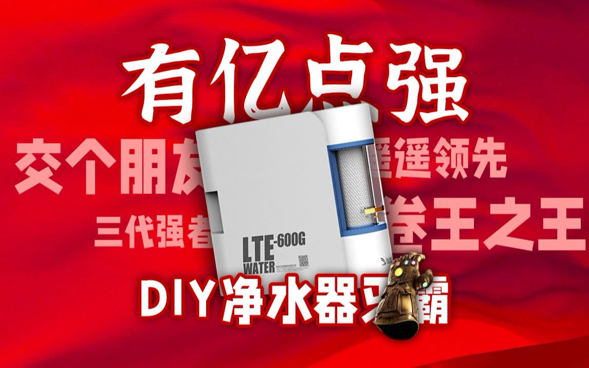

# 11 · BV1a82uYTEKD: 水智狮 "Three generations of DIY purifiers"

## 1. Metadata

| Field | Value |
|---|---|
| Title (zh) | DIY净水器三代编年史，揭开DIY面纱，钱别花刀背上！ |
| Title (en) | "A chronicle of three generations of DIY purifiers: exposing what's behind DIY, don't spend money in the wrong place!" |
| Uploader | 水智狮 |
| Link | https://www.bilibili.com/video/BV1a82uYTEKD |
| Plays | 115,874 (Bilibili view API, 2026-10-20) |
| Published | 2024-10-10 |
| Duration | 5:15 |
| aid | 113281725367402 |

**Sources used this run (2026-10-20 ~20:10 Asia/Shanghai):** anonymous `x/web-interface/view` API (HTTP 200); anonymous `x/v2/reply/main` + `x/v2/reply/reply` (HTTP 200) for pinned mall link and hot/child threads. **Nothing below comes from watching the video.** No yt-dlp / in-video frames this pass (Phase A).

Description: "DIY净水器都一样？哪哪都好？哪些说法是在蒙你？\n5分钟系统的说说市面顶流DIY净水器"

Note: view API title uses 「揭开DIY面纱」; prior survey had 「揭开DIY面纱」 vs older typo 「面底」 — using live API title.

## 2. Architecture (description + comments; video not watched)

Market overview of “generations” of DIY / **universal-filter** machines (rack → integrated box). Verified from pin/comments only:

- **Pinned:** mall link labeled **「通用DIY顶流净水器，三级通用滤芯」** (top DIY universal unit, **3-stage universal cartridges**).
- **Cover** (prior): enclosed render **LTE-600G WATER** (乐天鹅).
- Hot: commenters treat **乐天鹅** as the referenced product; one posts a photo and notes **水驱** (water-driven flush?) can’t be timed without an added relay.
- Internal stage order, pump, tank, UV: **not verifiable** without the video.

No mermaid water path: no verified stage chain beyond “三级通用滤芯” marketing wording.

## 3. Tags

| Dimension | Finding |
|---|---|
| Inlet method | Not verifiable |
| Filter stages | Pinned: **三级通用滤芯**. Details unverified |
| RO membrane & pump | 600G class implied by LTE cover / comment prices. Unverified for filmed unit |
| Storage | Tankless 600G class implied by product class only |
| Water safety | Hot: Xiaomi “零陈水” / TDS faucet called fake by @ハン君 (anecdote; uploader shushes) |
| Sterilization (UV) | Not mentioned |
| Heating | Not mentioned |
| Leak/flood protection | Hot: one buyer claims unit **burst / flooded room** after ~6 months (@ocean233333) — unverified |
| Structure & portability | Trend: rack DIY → **integrated** enclosed box (desc/cover). Hot: 集成水路 lowers assembly/repair cost (@蜂蜜蒸南瓜) |
| Electronics & smart | Hot: Xiaomi NFC on filters; LTE 水驱 not user-schedulable without relay |
| Brands | **乐天鹅 (LTE)** (cover + comments). Compared in thread to 先看评测’s own product, 钻芯, 迎春 |
| Cost (BOM) | Comment price sketch: 迎春600G ~¥516, 钻芯600G ~¥628, 乐天鹅600G ~¥847 (@冲劲人生) |
| Maintenance | Universal vs proprietary RO debate vs 先看 (hot) |

## 4. BOM

No DIY parts list. Uploader pinned **product / mall link** only:

| Item | Role | Source |
|---|---|---|
| 通用DIY顶流净水器（三级通用滤芯） | Ready-made universal-cartridge unit (affiliate) | Uploader pinned |

## 5. Problems / pitfalls

| Problem | Source | Solution mentioned? |
|---|---|---|
| LTE **水驱** can’t be scheduled | Hot (@知者乐水-) | **Suggested:** add a relay (DIY preference) |
| Xiaomi NFC filters; fake 零陈水 / fake TDS on faucet | Hot (@ハン君) | **Claimed:** first-cup TDS high while display shows teens — anecdote |
| Unit **burst / flooded** after ~半年 | Hot (@ocean233333) | None useful in thread |
| **开机断流** (faucet pauses a few seconds on start) on 800增强 / 600G | Hot + children | **Mentioned:** CS free stage-3 filter; poke nonwoven in cartridge port; waste port + **5 kg** relief valve; add pressure tank |
| 先看 claims “universal RO” but sells custom RO | Hot (@潘大天才) | Uploader agrees comparison is 拉踩 |
| Too many DIY brands to choose | Child | Price list only (迎春 / 钻芯 / 乐天鹅) |

## 6. Architecture screenshots

**No in-video frames this pass.** Cover from the prior survey:

*Cover: integrated enclosed universal-cartridge purifier (LTE-600G render).*
