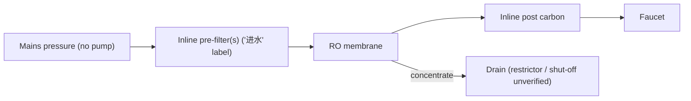
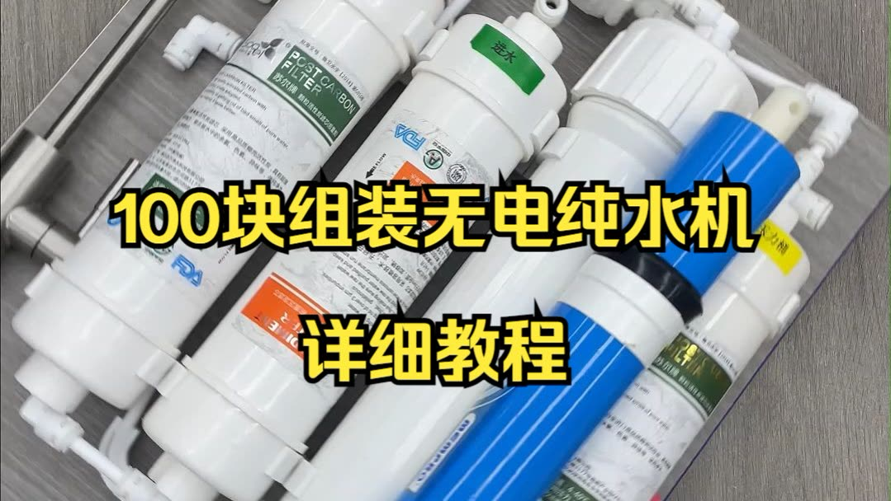

# 13 · BV1dCXLYVEZC: 西安无忧水务净水 "¥100 no-electricity RO machine, detailed tutorial"

## 1. Metadata

| Field | Value |
|---|---|
| Title (zh) | 100块组装无电纯水机超详细教程 |
| Title (en) | "Super-detailed tutorial: assemble a no-electricity pure-water (RO) machine for ¥100" |
| Uploader | 西安无忧水务净水 (same business as video [05](05-BV1RhPCeLEHP.md)) |
| Link | https://www.bilibili.com/video/BV1dCXLYVEZC |
| Plays | 97,480 (Bilibili search API, 2026-10-18) |
| Published | 2025-03-20 |
| Duration | 1:50 |

**Data limits for this video:** Bilibili returned HTTP 412 to this box before the video, its comments, or its audio could be fetched, and per the rate-limit rule Bilibili access was stopped. Only the search-API metadata/description (fetched before the block), the BiliPlus mirror metadata, and the uploader cover image (via the BiliPlus image mirror) were available. **Nothing below comes from watching the video.**

Description: empty.

## 2. Architecture (title and cover only)

- **"No-electricity" (无电) RO:** by the title, the RO membrane is driven by **mains water pressure only**, with no booster pump, solenoids, or control board. How waste-water shut-off is handled (e.g., a hydraulic shut-off or a flow restrictor) **isn't verifiable**.
- **Cover:** cartridges on a metal plate. From left: an inline cartridge labeled **"POST CARBON FILTER"**, an inline cartridge with a green **进水 (inlet)** sticker and FDA marks, a **blue RO membrane** (outside its housing) next to its housing, and another inline cartridge with a yellow label. A stainless faucet stem is visible top-left. All cartridges are slim **inline quick-connect** type, not 10" housings.

*Stage order is inferred from the labels on the cover and isn't verified.*

## 3. Tags

| Dimension | Finding |
|---|---|
| Inlet method | Mains pressure (title "无电") |
| Filter stages | Inline pre → RO → inline post carbon (cover, unverified order) |
| RO membrane & pump | RO, **no pump** (title) |
| Storage | Not verifiable |
| Water safety | FDA marks on cartridge labels (cover). No verified claims |
| Sterilization (UV) | Not mentioned |
| Heating | Not mentioned |
| Leak/flood protection | Not mentioned |
| Structure & portability | Compact inline cartridges on a plate. No electrics (title) |
| Electronics & smart | None ("no electricity") |
| Brands | Not verifiable |
| Cost (BOM) | About ¥100 (title) |
| Maintenance | Not available |

## 4. BOM

Not available beyond "¥100" (title).

## 5. Problems / pitfalls

The same uploader's related video "3.8水压不够 废水太多 如何解决？" (BV1mwXjYcEYh, "3.8 water pressure not enough, too much waste, how to fix?") suggests low mains pressure and high waste are known issues for pump-less RO. Not analyzed here.

## 6. Architecture screenshots

Cover image (not an in-video frame):

*Cover: slim inline cartridges (inlet pre-filter, RO membrane, post carbon) for a pump-less RO.*
