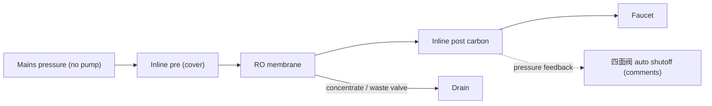

# 13 · BV1dCXLYVEZC: 西安无忧水务净水 "¥100 no-electricity RO machine, detailed tutorial"

## 1. Metadata

| Field | Value |
|---|---|
| Title (zh) | 100块组装无电纯水机超详细教程 |
| Title (en) | "Super-detailed tutorial: assemble a no-electricity pure-water (RO) machine for ¥100" |
| Uploader | 西安无忧水务净水 (same business as video [05](05-BV1RhPCeLEHP.md)) |
| Link | https://www.bilibili.com/video/BV1dCXLYVEZC |
| Plays | 97,790 (Bilibili view API, 2026-10-20) |
| Published | 2025-03-20 |
| Duration | 1:50 |
| aid | 114183165189345 |

**Sources used this run (2026-10-20 ~20:14 Asia/Shanghai):** anonymous `x/web-interface/view` API (HTTP 200); anonymous `x/v2/reply/main` (HTTP 200) for top/hot comments. **Nothing below comes from watching the video.** No yt-dlp / in-video frames this pass (Phase A).

Description: empty.

## 2. Architecture (title + cover + comments; video not watched)

- **Title:** **无电** (no electricity) RO for about **¥100** — mains pressure only; no booster pump / board.
- **Cover** (prior): slim **inline** cartridges on a plate — inlet-labeled pre, blue RO membrane + housing, **POST CARBON**, faucet stem.
- **Comments confirm key mechanical parts:**
  - Uploader: showroom feed **&lt; ~2 kg/cm²**, with a **pressure tank**, usable if demand is low; **waste is high** (@西安无忧水务净水).
  - Hot thread explains **四面阀** (4-way / auto-shutoff valve) as the no-power substitute for LPS + inlet solenoid: pure-side pressure closes feed when the faucet is shut (@kdelove).
  - Flow is **very slow** without a pump — often used to fill a drinking jug over hours (@Rinwind). Example: 0.25 MPa, 75G, ~8 L pure / hour with high waste ratio claimed (@OB酱丶).

*Pre/RO/post from cover labels; 四面阀 role from hot comments. Exact plumbing not filmed here.*

## 3. Tags

| Dimension | Finding |
|---|---|
| Inlet method | Mains pressure only (title 无电) |
| Filter stages | Inline pre → RO → post carbon (cover); waste valve + often 四面阀 (comments) |
| RO membrane & pump | RO, **no pump** (title). Commenters use 75G / 125G class membranes with enough pressure |
| Storage | Pressure tank recommended by uploader when pressure is low |
| Water safety | Not detailed |
| Sterilization (UV) | Not mentioned |
| Heating | Not mentioned |
| Leak/flood protection | Not mentioned |
| Structure & portability | Compact inline-on-plate; no electrics |
| Electronics & smart | None; mechanical 四面阀 instead of board |
| Brands | Uploader shop 西安无忧水务净水 |
| Cost (BOM) | ~¥100 (title). Hot: finished kits online ~¥300–400; one builder ~¥200+ parts |
| Maintenance | Low pressure → more concentrate (uploader / 四面阀 tip) |

## 4. BOM

No uploader itemized list in the pin (top comment is a viewer **「交作业了」** photo set, not a parts list). Title implies ~¥100 DIY. Hot mentions **四面阀**, check valves, waste valve, inline RO + post carbon, optional tank — not a complete shopping list.

## 5. Problems / pitfalls

| Problem | Source | Solution mentioned? |
|---|---|---|
| **Very slow** pure flow without pump | Hot (@Rinwind, @狮子小狛) | **Discussed:** fill a jug/缸; add cheap pump; or rely on tank + patience |
| “RO won’t work without boost” | Hot (@小肥莹1005) | **Uploader:** works with any pressure, just **lower output** |
| High waste ratio | Uploader reply | Acknowledged with tanked low-pressure demo |
| Can you omit 四面阀 / checks if manually valving the feed and skipping tank/faucet? | Hot (@kdelove) | **Yes (commenter):** manual inlet valve can replace 四面阀 + faucet; keep waste valve for ratio |
| Low mains pressure → higher concentrate share | @kdelove on 四面阀 | Inherent drawback noted |
| UF-only enough if you boil? | Hot | Split opinions; one says UF still tastes off vs RO |

## 6. Architecture screenshots

**No in-video frames this pass.** Cover from the prior survey:

*Cover: slim inline cartridges for a pump-less RO.*
