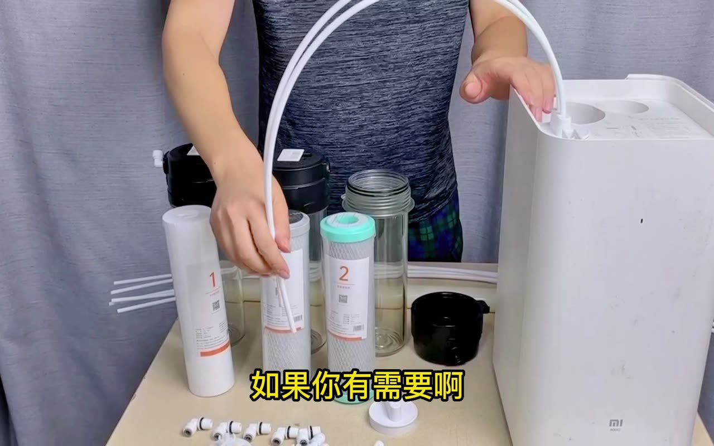

# 14 · BV1ZG411g73g: 另一半净水科技 "Converting a Xiaomi purifier to universal filters"

## 1. Metadata

| Field | Value |
|---|---|
| Title (zh) | 为什么把小米净水器改装成通用滤芯？因为是真的很省钱啊！（结尾有小惊喜） |
| Title (en) | "Why convert a Xiaomi purifier to universal filters? Because it really saves money! (small surprise at the end)" |
| Uploader | 另一半净水科技 (BiliPlus mirror lists the account as MATE空气净化, probably renamed) |
| Link | https://www.bilibili.com/video/BV1ZG411g73g |
| Plays | 97,232 (Bilibili search API, 2026-10-18) |
| Published | 2022-09-27 |
| Duration | 2:06 |

**Data limits for this video:** Bilibili returned HTTP 412 to this box before the video, its comments, or its audio could be fetched, and per the rate-limit rule Bilibili access was stopped. Only the search-API metadata/description (fetched before the block), the BiliPlus mirror metadata, and the uploader cover image (via the BiliPlus image mirror) were available. **Nothing below comes from watching the video.** The same uploader has related videos on the topic (BV19t4y1c7V9, BV1HA41117Vc, BV16e4y1h7Cn; not analyzed).

## 2. Architecture (cover only)

The cover shows a **Xiaomi under-sink purifier** (MI logo) with its cartridge bays opened and **white tubes routed out of the bays** to **external transparent universal housings**. Cartridges are labeled "1" (white, PP-like) and "2" (carbon block, green cap), with push-fit elbows on the table. So the approach seems to be: keep the brand machine's pump, RO, and electronics, and **replace the proprietary composite cartridges with external generic housings** connected by tubing (**unverified**). Whether the RO cartridge is also replaced isn't visible.

*Inferred from the cover. Unverified.*

## 3. Tags

| Dimension | Finding |
|---|---|
| Inlet method | Not verifiable |
| Filter stages | Generic external housings replacing brand cartridges (cover) |
| RO membrane & pump | Presumably the Xiaomi machine's own (unverified) |
| Storage | Not verifiable |
| Water safety | Not mentioned |
| Sterilization (UV) | Not mentioned |
| Heating | Not mentioned |
| Leak/flood protection | Not mentioned |
| Structure & portability | Brand enclosure plus external housings |
| Electronics & smart | Brand board retained (unverified) |
| Brands | Xiaomi |
| Cost (BOM) | "Saves a lot" (title, no numbers) |
| Maintenance | The point is cheaper generic cartridges |

## 4. BOM

Not available.

## 5. Problems / pitfalls

Not available.

## 6. Architecture screenshots

Cover image (not an in-video frame):

*Cover: the Xiaomi unit's cartridge bays tubed out to external transparent universal housings.*
