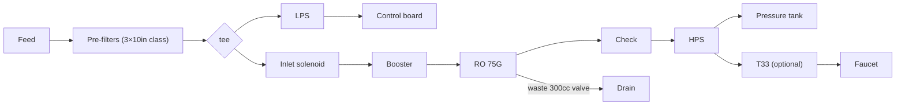

# 16 · BV1vr421t7t8: 锦程0319 "DIY purifier, a must-watch for beginners"

## 1. Metadata

| Field | Value |
|---|---|
| Title (zh) | 净水器DIY，小白必看！手把手教你，0基础也能搞定！ |
| Title (en) | "Purifier DIY, a must-watch for beginners! Step by step, doable with zero background!" |
| Uploader | 锦程0319 |
| Link | https://www.bilibili.com/video/BV1vr421t7t8 |
| Plays | 79,270 (Bilibili view API, 2026-10-20) |
| Published | 2024-04-04 |
| Duration | 19:22 |
| aid | 1402719360 |

**Sources used this run (2026-10-20 ~20:20 Asia/Shanghai):** anonymous `x/web-interface/view` API (HTTP 200); anonymous `x/v2/reply/main` + `x/v2/reply/reply` (HTTP 200) for pinned Feishu link, BOM comment (text + image presence), wiring colors, and hot pitfalls. **Nothing below comes from watching the video.** No yt-dlp / in-video frames this pass (Phase A). Related: install counterpart [15](15-BV18m421j7A6.md); longer “upgraded” BV1YW42197wu not fetched.

Description: same seller kit offer as #15 — **75G 框架 ¥680** / **75G 挂板 ¥549**; Feishu 「澄什」 DIY RO doc.

## 2. Architecture (comments + description; video not watched)

Assembly tutorial for the same **75G tanked** DIY line as #15.

Verified from comments (not video):

- **Control-board wiring** (uploader hot comment): yellow→LPS, blue→HPS, black→inlet solenoid, red→waste valve (**300 cc**), green→booster pump, white→PSU−, pink/purple→PSU+ (only PSU polarity matters).
- **LPS vs inlet solenoid:** uploader says in their layout they sit on two legs of a **tee (“并联”)**, so order is about plumbing convenience; discusses LPS before stage-1 vs after stage-1 vs after stage-3 trade-offs (clogging vs detecting true feed pressure).
- **T33** optional for taste; uploader notes possible but low reverse-contamination risk on a pressurized faucet line; uses NSF / reputable T33; OK to omit.
- **Tankless high-flux** alternative needs ≥**400G** membrane + larger pump/PSU/3-分 plumbing; more 陈水 unless 零陈水 (水驱 small tank or delay relay) — uploader discourages for typical home use.
- Successful builder: flush two tanks, TDS **200→5** (@忆恋前尘). Dimensions given by uploader: body ~**37×23×46 cm**, tank Ø**24×36 cm**.

*Wiring/tee relationship from uploader comments; pre-filter count inferred from kit class + LPS placement discussion — treat as comment-supported schematic, not a filmed BOM.*

## 3. Tags

| Dimension | Finding |
|---|---|
| Inlet method | Kitchen cold feed (install context) |
| Filter stages | 75G RO + optional T33; 3-stage pre discussed via LPS placement |
| RO membrane & pump | 75G class; waste valve **300 cc** (wiring note) |
| Storage | Pressure tank (default); high-flux tankless discouraged for newbies |
| Water safety | T33 reverse-contamination risk debated; NSF T33 preferred if used |
| Sterilization (UV) | Not mentioned |
| Heating | Not mentioned |
| Leak/flood protection | Leak risk in seller pain points; one builder adds ~¥10 leak protector on feed |
| Structure & portability | Frame/plate; sizes above |
| Electronics & smart | Generic 电脑板 + color wiring map |
| Brands | Kit sellers; fittings: 中荷 1817-c / 2817-c note; 苏尔 T33 / gold-label filters mentioned |
| Cost (BOM) | Kits ¥549/680; DIY parts ~**¥600+** (uploader); one build ~¥630–800+ shipping |
| Maintenance | Fitting mismatches; flush order; RO elbow with built-in check |

## 4. BOM

- Description kits: **¥680** frame / **¥549** plate (75G).
- Uploader comment: **配件清单** posted as **images** in the comment (pictures present in API; **not OCR’d** this Phase A pass). Text portion only gives the **wiring map** (above).
- Feishu doc linked in pin (external; not fetched).
- Correction post: **中荷 2817-c** may not fit the pump — use **1817-c** + PTFE, or 亿星 3分外牙→2分 elbow **4046+O**.

## 5. Problems / pitfalls

| Problem | Source | Solution mentioned? |
|---|---|---|
| LPS / inlet valve order | Hot (@佛系玩家小波) | **Uploader:** tee “并联”; place LPS for wiring convenience; discuss clog vs sensing trade-offs |
| T33 taste vs contamination | Same thread | **Uploader:** optional; NSF parts; low reverse-bacteria risk on positive-pressure line |
| Pump pulses / “缺水” loop | Hot (@superoooxiang) | **Tips:** short LPS to test; LPS failure or low pressure; some say skip LPS on stable municipal feed |
| No flow into RO on first flush | Hot (@傻傻傻笑笑笑) | **Yes:** RO inlet elbow was a **check-valve elbow** installed wrong; swap fittings |
| Pure faucet TDS high, waste low | Same | **Yes:** **pure and waste ports swapped** (blind push-fit) |
| Wrong board / extra fittings; M3/M4/M5 screws | Same / others | Buy correct kit; measure screws |
| 2817-c won’t fit pump | Uploader correction | **Yes:** 1817-c or alternate elbow |
| Want no tank | Hot | **Uploader:** need ≥400G redesign + 陈水 mitigation — not recommended for beginners |

## 6. Architecture screenshots

**No in-video frames this pass.** Cover from the prior survey remains cover-only evidence. BOM images live on the Bilibili comment CDN (not saved into `img/` this run).
