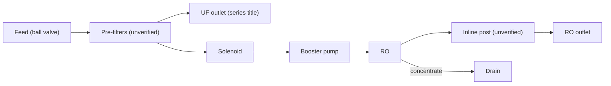

# 17 · BV1X3411c74Z: 无聊的改造 "DIY household RO + UF purifier (part 1 of 3)"

## 1. Metadata

| Field | Value |
|---|---|
| Title (zh) | diy组装家用净水器ro反渗透超滤水机（3/1） |
| Title (en) | "DIY assembled household purifier: RO reverse osmosis + UF water machine (part 1 of 3)" |
| Uploader | 无聊的改造 |
| Link | https://www.bilibili.com/video/BV1X3411c74Z |
| Plays | 63,868 (Bilibili view API, 2026-10-20) |
| Published | 2022-06-27 |
| Duration | 8:55 |
| aid | 512781307 |

**Sources used this run (2026-10-20 ~20:22 Asia/Shanghai):** anonymous `x/web-interface/view` API (HTTP 200); anonymous `x/v2/reply/main` (HTTP 200) for hot comments (no uploader pin). **Nothing below comes from watching the video.** No yt-dlp / in-video frames this pass (Phase A). Series continues BV1kW4y1z7cV (3/2), BV1vY4y1E7FU (3/3) — not fetched.

Description: empty.

## 2. Architecture (titles + cover + comments; video not watched)

- **Series titles:** **RO + UF dual outlet**.
- **Cover** (prior): solenoid, pressure switch, inline cartridge, LCD controller, ball valve, booster pump.
- Hot: commenter recommends **TB ~¥360 100G tanked** finished units with **pure-water flush** to cut first-cup TDS (@电疗专业杨医玍). Another notes first-cup TDS issue and a **pressure-tank backflush + delay waste valve** improvement (@专业防空大尾猫).
- Exact UF vs RO tee position still **unverified** without video.

*Title/cover-level schematic; not comment-verified stage-by-stage.*

## 3. Tags

| Dimension | Finding |
|---|---|
| Inlet method | Not verifiable |
| Filter stages | RO + UF dual outlet (series titles) |
| RO membrane & pump | Booster + RO (cover). G-rating unverified |
| Storage | Hot discusses tanked 100G finished alternatives |
| Water safety | First-cup high TDS after idle (hot) |
| Sterilization (UV) | Not mentioned |
| Heating | Not mentioned |
| Leak/flood protection | Not mentioned |
| Structure & portability | Open assembly (cover); “cabinet opens → flies free” joke (@tomboeda) |
| Electronics & smart | LCD controller (cover) |
| Brands | DIY; commenters compare to 小米 + external pre-filters |
| Cost (BOM) | Cover “超低成本”; hot finished ~¥360 / year-3 filters ~¥40 (anecdote) |
| Maintenance | Rural high TDS clogs pre-stages — settle / coarse pre (@凯申物流…) |

## 4. BOM

No pin / no itemized list in hot text.

## 5. Problems / pitfalls

| Problem | Source | Solution mentioned? |
|---|---|---|
| First-cup high TDS after long idle | Hot (@晴天尕清新) | **Discussed:** buy tanked unit with pure flush; or tank backflush + delay waste valve |
| Rural / well water clogs 5-stage pre | Hot | **Yes:** settling drum; coarse pre stage; dual pre banks |
| DIY noise / consumables vs brand | Hot (@HowardWWWWG) | **Framed:** Xiaomi + DIY PP/carbon pre in front |
| UF-only if you boil? | Hot | Commenter says OK |
| Dual-RO for bottled-water taste | Hot | Taste often PH dosing (娃哈哈) not more RO |

## 6. Architecture screenshots

**No in-video frames this pass.** Cover from the prior survey remains cover-only evidence.
