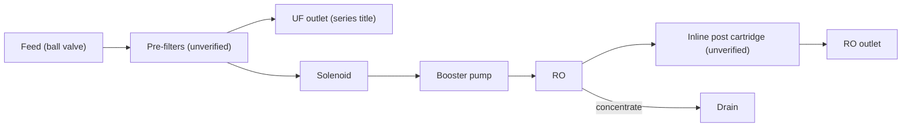
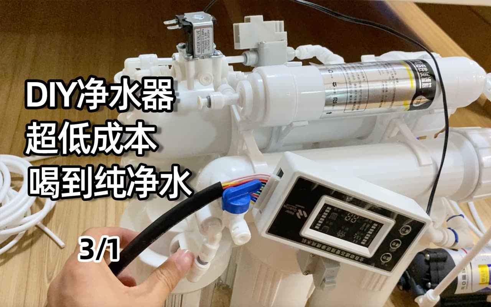

# 17 · BV1X3411c74Z: 无聊的改造 "DIY household RO + UF purifier (part 1 of 3)"

## 1. Metadata

| Field | Value |
|---|---|
| Title (zh) | diy组装家用净水器ro反渗透超滤水机（3/1） |
| Title (en) | "DIY assembled household purifier: RO reverse osmosis + UF water machine (part 1 of 3)" |
| Uploader | 无聊的改造 |
| Link | https://www.bilibili.com/video/BV1X3411c74Z |
| Plays | 63,862 (Bilibili search API, 2026-10-18) |
| Published | 2022-06-27 |
| Duration | 8:55 |

**Data limits for this video:** Bilibili returned HTTP 412 to this box before the video, its comments, or its audio could be fetched, and per the rate-limit rule Bilibili access was stopped. Only the search-API metadata/description (fetched before the block), the BiliPlus mirror metadata, and the uploader cover image (via the BiliPlus image mirror) were available. **Nothing below comes from watching the video.** The series continues in BV1kW4y1z7cV ("3/2", 12:03, title mentions **RO pure water + UF dual outlet**) and BV1vY4y1E7FU ("3/3", 12:30, "RO membrane dual outlet"), which weren't analyzed. A YouTube copy exists (`xyKhcBAoQgo`), but YouTube blocked downloads ("confirm you're not a bot") and its page has no description.

## 2. Architecture (titles and cover only)

- **RO + UF with dual outlets** (series titles): an RO drinking line plus a UF line.
- **Cover** (close-up of the assembled unit): an **inlet/waste-type solenoid valve** (metal coil, "WATER VALVE" label) on top, a white **pressure-switch-style block** beside it, an **inline cartridge with a stainless sleeve**, a **control box with an LCD panel**, a **blue ball valve**, push-fit tees, the black **booster pump** (bottom right), and a coil of tubing. Text: "DIY净水器 / 超低成本 / 喝到纯净水" (DIY purifier, ultra-low cost, drink pure water).

*The arrangement is inferred from the titles and cover, not verified. Where the UF sits relative to the RO is unknown.*

## 3. Tags

| Dimension | Finding |
|---|---|
| Inlet method | Ball valve visible. Method unverified |
| Filter stages | RO + UF dual outlet (series titles) |
| RO membrane & pump | Booster pump visible. Flux unknown |
| Storage | Not verifiable |
| Water safety | Not mentioned |
| Sterilization (UV) | Not mentioned |
| Heating | Not mentioned |
| Leak/flood protection | Not mentioned |
| Structure & portability | Not verifiable |
| Electronics & smart | LCD control box, solenoid, pressure switch (cover) |
| Brands | Not verifiable |
| Cost (BOM) | "Ultra-low cost" (cover text) |
| Maintenance | Not available |

## 4. BOM

Not available.

## 5. Problems / pitfalls

Not available.

## 6. Architecture screenshots

Cover image (not an in-video frame):

*Cover: the electrical and control parts of a pumped RO (solenoid valve, pressure switch, LCD control box, booster pump).*
