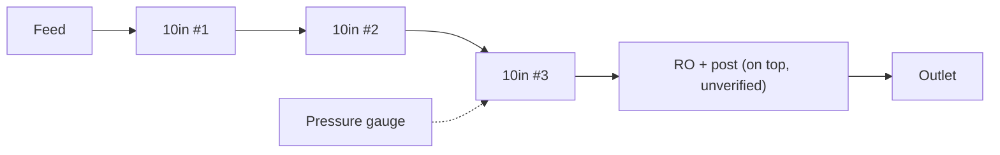
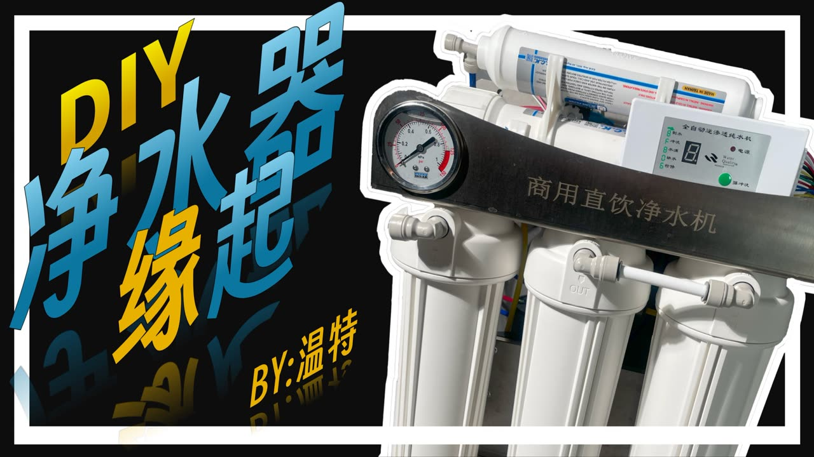

# 18 · BV1mF15YuEfh: 温特的移动城堡 "Why I recommend you DIY a purifier (step-by-step series, part 1)"

## 1. Metadata

| Field | Value |
|---|---|
| Title (zh) | 我为什推荐你 DIY 一台净水器 \| 保姆级教程系列（1）\| 温特 |
| Title (en) | "Why I recommend you DIY a purifier \| Step-by-step tutorial series (1) \| Winter" |
| Uploader | 温特的移动城堡 |
| Link | https://www.bilibili.com/video/BV1mF15YuEfh |
| Plays | 62,646 (Bilibili search API, 2026-10-18) |
| Published | 2024-10-28 |
| Duration | 5:03 |

**Data limits for this video:** Bilibili returned HTTP 412 to this box before the video, its comments, or its audio could be fetched, and per the rate-limit rule Bilibili access was stopped. Only the search-API metadata/description (fetched before the block), the BiliPlus mirror metadata, and the uploader cover image (via the BiliPlus image mirror) were available. **Nothing below comes from watching the video.**

Description: "手把手教会你选购组装的每一步，分享你我踩过的每个坑" (teaches every step of buying and assembling, and shares every pitfall we've hit).

**Series context (from search-result titles and tags only):** parts 2–4 cover "core components' working principles", with tags **高压开关 (HP switch), 低压开关 (LP switch), 进水电磁阀 (inlet solenoid), 漏水保护器 (leak protector), 净水器漏水 (purifier leaks), 废水比 (waste ratio)**. Parts 5–7 cover installation, with tags **切管刀 (tube cutter), cck, 净水器支架/挂板 (stand / hanging plate), 生料带 (PTFE tape), 后置活性炭 (post carbon), t33, 废水电磁阀 (waste solenoid)**. Videos in the series: BV1bQSoYuEPi, BV1NHDYYvEi3, BV1eADYYmEk6, BV1X2UXYwEG8, BV1eGzYYHEnw, BV1vgzYYXEw9 (not analyzed; all rank below the top 20).

## 2. Architecture (cover only)

The cover shows a **commercial-style rack purifier** ("商用直饮净水机" printed on a dark steel bracket) with **3 × 10" housings** (IN/OUT ports linked by tubing), a **pressure gauge** on the bracket, an inline cartridge on top, and a **control panel** (Chinese labels such as 全自动反渗透纯水机, with a 7-segment display and indicator LEDs). This part is the "why DIY" motivation episode, so its own water path isn't verifiable.

*Matches the cover only. Unverified.*

## 3. Tags

| Dimension | Finding |
|---|---|
| Inlet method | Not verifiable |
| Filter stages | 3 × 10" + inline (cover) |
| RO membrane & pump | Not verifiable |
| Storage | Not verifiable |
| Water safety | Not mentioned |
| Sterilization (UV) | Not mentioned |
| Heating | Not mentioned |
| Leak/flood protection | Leak protector covered later in the series (tags) |
| Structure & portability | Steel-bracket rack (cover). Stand vs plate discussed in part 5 (tags) |
| Electronics & smart | Control panel and pressure gauge (cover). HP/LP switch and solenoids covered in parts 2–4 (tags) |
| Brands | CCK (series tags) |
| Cost (BOM) | Not available |
| Maintenance | Not available |

## 4. BOM

Not available.

## 5. Problems / pitfalls

The description promises "every pitfall"; specifics not accessible.

## 6. Architecture screenshots

Cover image (not an in-video frame):

*Cover: a 3-housing rack purifier with a pressure gauge and an RO control panel.*
