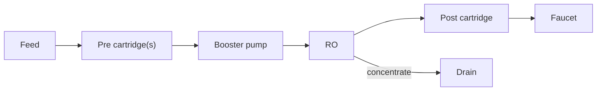
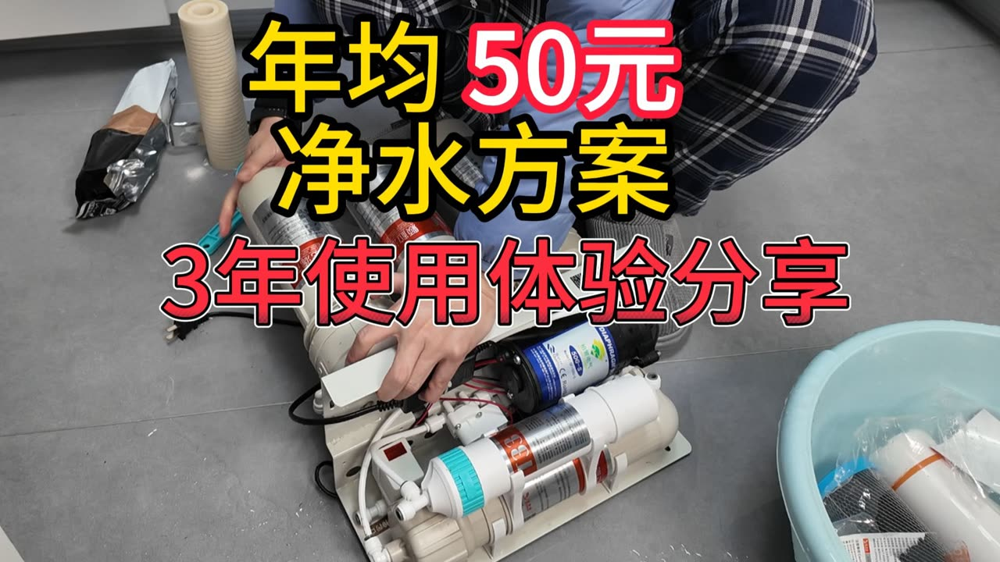

# 19 · BV1wDdGYXEPt: 红星小学中队长 "3 years with a DIY purifier"

## 1. Metadata

| Field | Value |
|---|---|
| Title (zh) | DIY净水器3年使用体验分享 |
| Title (en) | "Sharing 3 years of experience using a DIY purifier" |
| Uploader | 红星小学中队长 |
| Link | https://www.bilibili.com/video/BV1wDdGYXEPt |
| Plays | 59,322 (Bilibili search API, 2026-10-18) |
| Published | 2025-04-10 |
| Duration | 6:40 |

**Data limits for this video:** Bilibili returned HTTP 412 to this box before the video, its comments, or its audio could be fetched, and per the rate-limit rule Bilibili access was stopped. Only the search-API metadata/description (fetched before the block), the BiliPlus mirror metadata, and the uploader cover image (via the BiliPlus image mirror) were available. **Nothing below comes from watching the video.**

Description: empty. Search tags: 水电预留 (plumbing provisions), 全屋净水, 购物分享, 净水, 净水器, 我家的装修经验分享, DIY, RO反渗透. The uploader's other videos include "换了根10元滤芯，TDS直接到0了" (BV1iX4y1D72J) and a critical take on purifier sellers (BV144dUBsEmv); neither was analyzed.

**Why it matters:** this is the only top-20 video about **long-term (3-year) ownership and maintenance**.

## 2. Architecture (cover only)

The cover shows a **compact plate-mounted RO** lying on the floor during a filter change: a white base plate, a **booster pump** (blue label), **inline quick-change cartridges** (one with a teal cap and a red "B…" label), a small control box, and the power cord. A replacement PP-style cartridge and a basin of old cartridges sit nearby. Cover text: **"年均50元 净水方案 / 3年使用体验分享"** ("a water-purification plan costing ¥50 a year on average").

*A generic pumped-RO layout matching the visible parts. Stage list unverified.*

## 3. Tags

| Dimension | Finding |
|---|---|
| Inlet method | Not verifiable |
| Filter stages | Inline cartridges (cover). Count unverified |
| RO membrane & pump | Booster pump visible |
| Storage | Not verifiable |
| Water safety | Not mentioned |
| Sterilization (UV) | Not mentioned |
| Heating | Not mentioned |
| Leak/flood protection | Not mentioned |
| Structure & portability | Compact base plate. Easy to lift out for service (cover) |
| Electronics & smart | Small control box (cover) |
| Brands | Not verifiable |
| Cost (BOM) | Running cost about **¥50/year** (cover claim) |
| Maintenance | **Topic: 3-year use and filter changes** |

## 4. BOM

Not available.

## 5. Problems / pitfalls

Not available.

## 6. Architecture screenshots

Cover image (not an in-video frame):

*Cover: a compact plate-mounted pumped RO with inline cartridges, shown during maintenance.*
