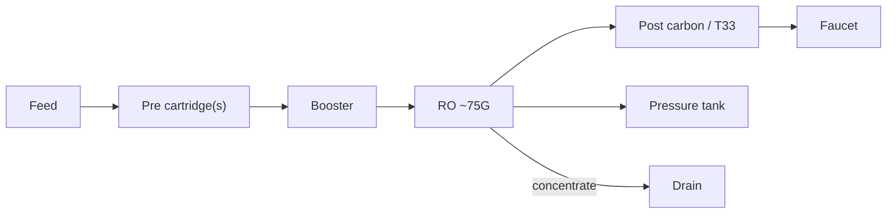

# 19 · BV1wDdGYXEPt: 红星小学中队长 "3 years with a DIY purifier"

## 1. Metadata

| Field | Value |
|---|---|
| Title (zh) | DIY净水器3年使用体验分享 |
| Title (en) | "Sharing 3 years of experience using a DIY purifier" |
| Uploader | 红星小学中队长 |
| Link | https://www.bilibili.com/video/BV1wDdGYXEPt |
| Plays | 59,381 (Bilibili view API, 2026-10-20) |
| Published | 2025-04-10 |
| Duration | 6:40 |
| aid | 114313708700808 |

**Sources used this run (2026-10-20 ~20:26 Asia/Shanghai):** anonymous `x/web-interface/view` API (HTTP 200); anonymous `x/v2/reply/main` (HTTP 200) for **pinned mall links** + hot long-term maintenance tips. **Nothing below comes from watching the video.** No yt-dlp / in-video frames this pass (Phase A).

Description: empty. Prior search tags: 水电预留, 全屋净水, DIY, RO反渗透, etc.

**Why it matters:** only top-20 entry focused on **~3-year ownership / running cost** (cover: 「年均50元」).

## 2. Architecture (pin + cover + comments; video not watched)

- **Cover** (prior): compact **plate-mounted** pumped RO with inline cartridges during a filter change; 「年均50元」.
- **Pinned:** mall links for the **3-year unit** (promo code **B3883** for free filters); notes **大胖瓶** needs clearance; unit **without enclosure** (“罩没啥用”).
- Hot identifies it as a **乐天鹅 / 乐天**-class DIY machine with **post-carbon + T33**; commenters debate bacteria on post-carbon and whether to add **UV** on the outlet (@Mishimaling).
- Flux: commenters treat it as **75G + pressure tank** (uploader: “带桶啊 出水很快”) (@欧尼酱Official thread).
- Newer shop **A-series** said to move 5-stage→3-stage, 100G/400G options, 米家 support (@拾光xzj) — **not** confirmed as this video’s hardware.

*Tank + ~75G from comments; post-carbon/T33 from hot identification; exact stage count unverified.*

## 3. Tags

| Dimension | Finding |
|---|---|
| Inlet method | Under-sink / plate mount (cover) |
| Filter stages | Pumped RO + post carbon/T33 (comments). Pin: shop DIY kit |
| RO membrane & pump | ~75G tanked (comments). Hard-water user: 150G RO + 3.2G tank anecdote |
| Storage | Pressure tank (uploader + comments) |
| Water safety | Hot: post-carbon biofilm risk; UV on outlet suggested for direct drink |
| Sterilization (UV) | Suggested in comments — not confirmed on uploader’s unit |
| Heating | Not mentioned |
| Leak/flood protection | Not mentioned |
| Structure & portability | Compact plate; no enclosure (pin). Check space for 大胖瓶 |
| Electronics & smart | Small control box (cover). Newer A-series: 米家 (comment) |
| Brands | Pin shop links; hot: 乐天鹅 / 乐天; 陶氏 RO on other builds |
| Cost (BOM) | Cover **~¥50/year**. Hot: DIY filters ~¥30/year vs Xiaomi hundreds |
| Maintenance | Color-based PP change; TDS rejection % and flow-decay formulas (@开心小小喵) |

## 4. BOM

No DIY parts table. Uploader **pinned product links** (mall) + filter promo **暗号 B3883**; notes enclosure optional. Recorded as affiliate / shop BOM, not a rack parts list.

## 5. Problems / pitfalls

| Problem | Source | Solution mentioned? |
|---|---|---|
| Post-carbon / T33 **bacterial growth**; not for cold direct-drink | Hot (@Mishimaling) | **Suggested:** boil, or add flow-sensing **UV** on outlet |
| 75G too slow | Hot | **Uploader:** use **pressure tank** — faucet flow is from tank |
| When to replace filters? | Hot | **Detailed tip:** PP by color (milk-chocolate → change); carbon every 3–4 PP changes; RO by TDS rejection & flow remaining % |
| Hard water / muddy feed | Hot (@开心小小喵) | Frequent PP; want large pre housing but no space |
| Old 5-stage kit hard to service vs new A-series | Hot (@拾光xzj) | **Advice:** buy newer A-series if shopping now |
| PP → PVDF UF washable; fill own GAC | Hot (@爆炒知了猴) | Cost-saving tip (uploader amused) |

## 6. Architecture screenshots

**No in-video frames this pass.** Cover from the prior survey remains cover-only evidence.
