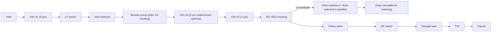
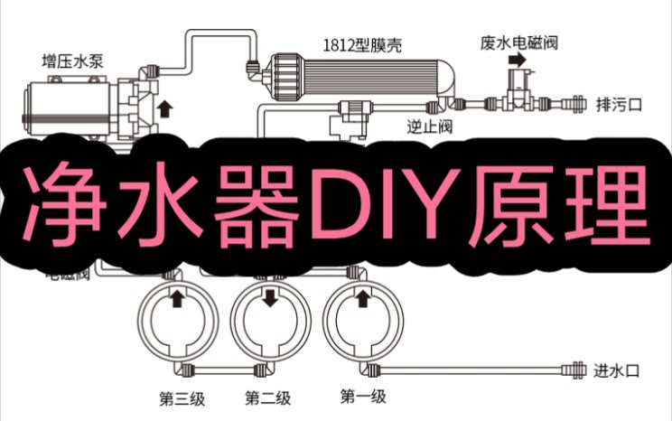

# 20 · BV1ri4y1k71v: 不喝奶的鱼 "DIY purifier principles, full process" (reprint)

## 1. Metadata

| Field | Value |
|---|---|
| Title (zh) | DIY净水器原理丨详细全过程分享 |
| Title (en) | "DIY water purifier principles: detailed full-process share" |
| Uploader | 不喝奶的鱼 (**reprint**. The description says `[转载]https://youtu.be/13AZ_KRE73g`) |
| Link | https://www.bilibili.com/video/BV1ri4y1k71v |
| Plays | 58,410 (Bilibili search API, 2026-10-18) |
| Published | 2022-03-25 |
| Duration | 4:14 |

**Sources used:** Bilibili search-API metadata; the **original YouTube video's public description** (13AZ_KRE73g, read 2026-10-18). That description is a full narration of the video, in Traditional Chinese and written from Taiwan (it mentions 110 V). The Bilibili video itself couldn't be downloaded (HTTP 412), and YouTube blocked the download ("confirm you're not a bot").

## 2. Architecture

Everything below comes **from the original YouTube description** (paraphrased and translated):

1. **Pre-filtration:** 2–3 × **10" housings**. Water flows from the outside of the cartridge to the inside, so if the inside is dirtier than the outside, the cartridge is installed backwards. The first cartridge is 5 µm, the last is 1 µm, and an optional middle one is 5 µm activated carbon or resin. Taiwan-made NSF-certified cartridges cost about NT$30 each.
2. **RO (4th stage):** removes scale. RO always produces waste. A **flow restrictor (废水比)** on the waste port sets the ratio, about **1 cup pure to 2–3 cups waste**.
3. **Stopping waste when the faucet is closed:** add a **high-pressure switch** (high pressure cuts power, low pressure restores it) and a **solenoid valve** (open when powered). Arrows mark the flow direction.
4. **Booster pump:** RO needs more pressure, and even 5-floor building pressure can't toggle the HP switch. The pump raises downstream pressure. It must go **after the first housing** to avoid large sediment, so the housing materials on either side may differ.
5. **Check valve:** without it, pure water drains back out through the waste port after the solenoid closes, pressure drops, and production restarts in an endless cycle. It looks like a plain L-elbow with metal parts inside.
6. **Low-pressure switch:** a pump running when the water supply cuts out gets damaged, so the LP switch cuts power when there's no water.
7. **Tank:** to avoid slow output, add a **storage tank**. Because water can sit in the tank too long, or to improve taste, add a **T33** after it.
8. **Controller:** the circuit has no indicator lights, so a **controller** is usually added. Wire it per its manual (the parts shown are 110 V). Two leftover wires can drive an **extra solenoid across the flow restrictor** for flushing.
9. **Waste-water reuse:** the "waste" is clean enough for washing and mopping, and the waste flow tells you the unit's condition.
10. **Troubleshooting:** the unit kept discharging waste and the pump was silent, so the transformer was faulty (found with a multimeter) and replaced.

The cover diagram (Simplified Chinese) labels a **booster pump → 1812 membrane housing → check valve**, a **waste solenoid → drain outlet**, three stages (第一/二/三级), an inlet, and a solenoid valve.

*The description gives the components and the reasons for each. The exact placement of the LP switch, solenoid, and HP switch is drawn according to the stated functions plus the cover diagram (pump → 1812 housing → check valve; waste solenoid → drain). The exact positions of the LP switch, inlet solenoid, and HP switch are not stated.*

## 3. Tags

| Dimension | Finding |
|---|---|
| Inlet method | Not stated |
| Filter stages | 2–3 × 10" (5 µm → [carbon/resin] → 1 µm) → RO → (tank) → T33 |
| RO membrane & pump | 1812 membrane housing (cover). Booster pump after the first housing |
| Storage | Storage tank (optional, "to avoid slow output") |
| Water safety | T33 after the tank for water that sat too long. NSF-certified cartridges mentioned |
| Sterilization (UV) | Not mentioned |
| Heating | Not mentioned |
| Leak/flood protection | Not mentioned |
| Structure & portability | Not mentioned |
| Electronics & smart | HP/LP switches, solenoids, check valve, optional controller. Parts are 110 V (Taiwan) |
| Brands | Not mentioned |
| Cost (BOM) | Cartridges about NT$30 each |
| Maintenance | Reverse-flow check on dirty cartridges. Use waste flow as a health indicator. Multimeter troubleshooting |

## 4. BOM

Not given (only the cartridge price).

## 5. Problems / pitfalls raised

| Problem | Solution mentioned? |
|---|---|
| A cartridge installed backwards (inside dirtier than outside) | Yes: flow goes outside → inside |
| Waste keeps flowing with the faucet closed | Yes: HP switch + solenoid |
| Endless restart cycling | Yes: check valve |
| Pump damaged when the water supply cuts out | Yes: LP switch |
| Pump damaged by sediment | Yes: pump after the first housing |
| Slow output | Yes: storage tank |
| Water sitting in the tank, taste | Yes: T33 after the tank |
| Unit keeps discharging waste and the pump is silent | Yes: a faulty transformer, found with a multimeter |

## 6. Architecture screenshots

In-video frames couldn't be extracted (Bilibili HTTP 412; YouTube bot-check). This is the **Bilibili cover**, which is a plumbing diagram partly covered by title text:

*Cover: the plumbing diagram shows booster pump → 1812 membrane housing → check valve; waste solenoid → drain; stages 1–3 from the inlet; solenoid valve.*
